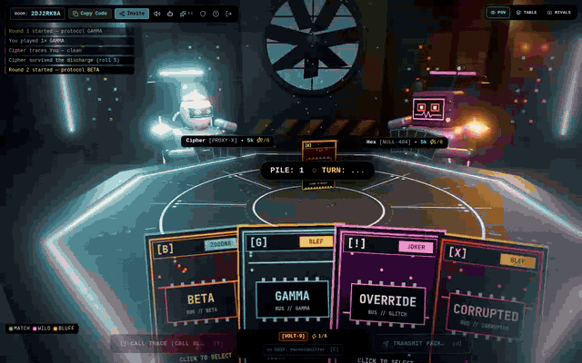
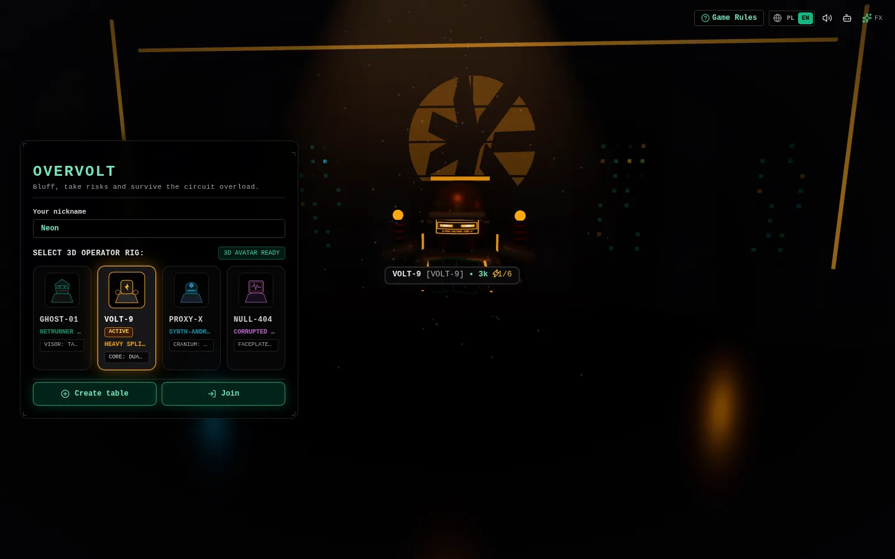
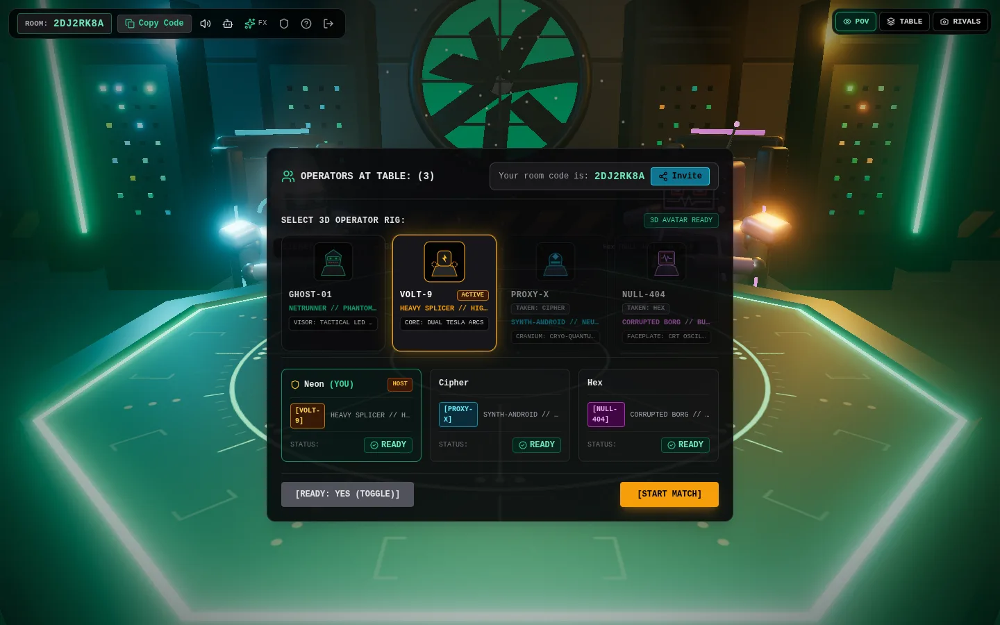
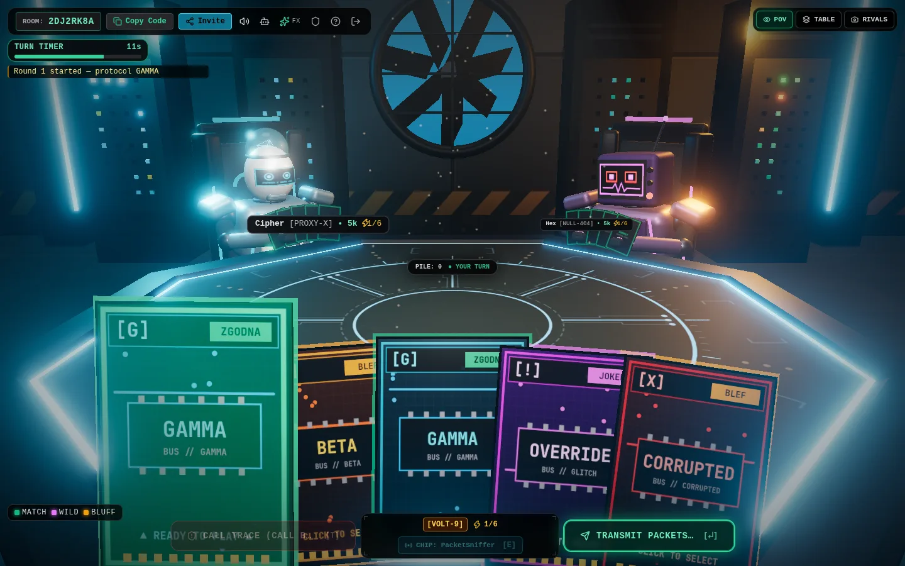
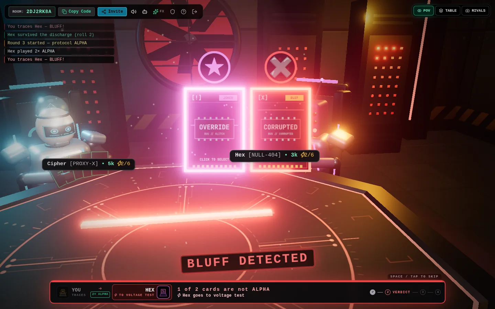
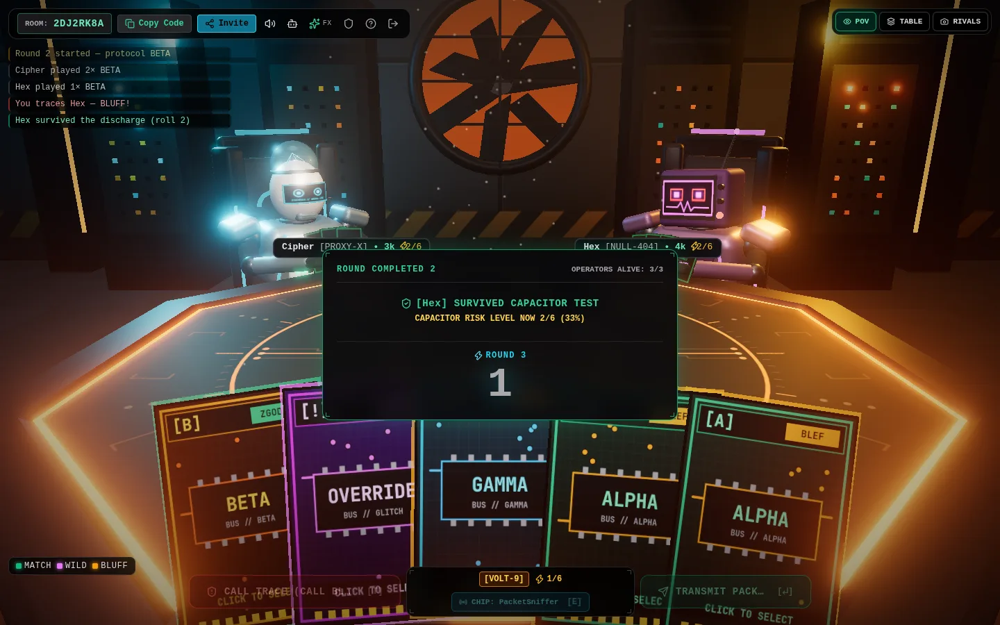
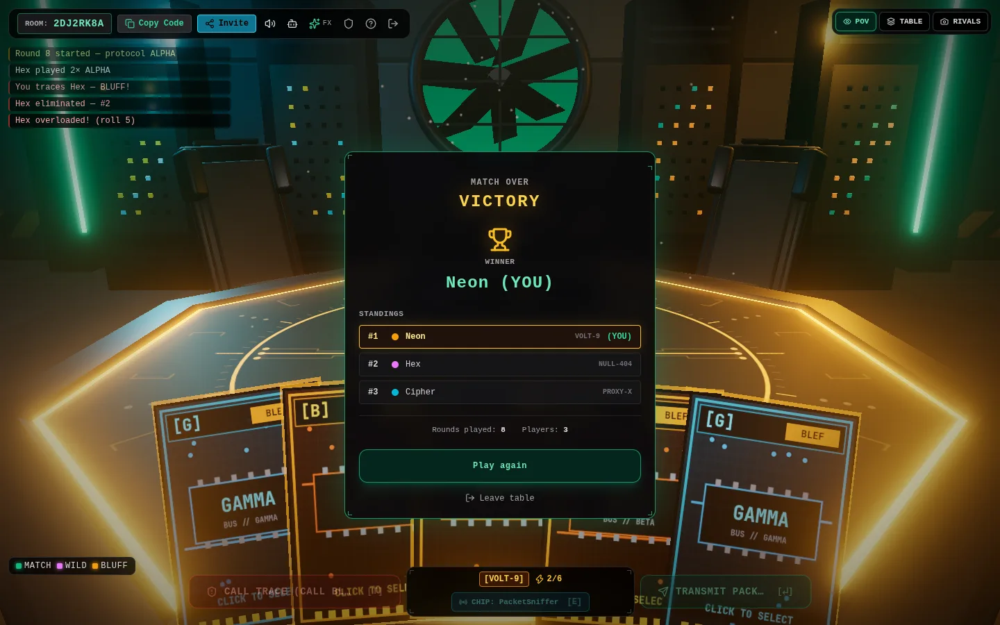

# Project: Overclock (Dead Circuit)

> A browser-based, turn-based bluffing game for 2–4 players. Play face-down data packets, lie or
> tell the truth, and whoever loses the challenge sits down for a voltage test: a neuro-capacitor
> whose short-circuit risk climbs with every round survived. Setting: an underground bunker, CRT
> terminals, lo-fi cyberpunk.

No install, no accounts: create a room, send your friends the link and play in the browser, on
desktop or phone.

<p align="center">
  
</p>

<p align="center"><a href="docs/assets/gameplay.mp4">▶ Watch a full 3-player match (MP4, ~2 min)</a></p>

| | |
| :---: | :---: |
|  |  |
| **Home:** pick a nickname and a 3D operator | **Lobby:** invite link, operator picks, ready check |
|  |  |
| **Your turn:** select packets and transmit | **TRACE:** cards are revealed, a bluff is caught |
|  |  |
| **Round summary:** who survived, current risk | **Match over:** winner and standings |

---

## How to play

1. **Deal.** Every operator gets 5 cards and the server rolls the **table protocol**
   (`Alpha`, `Beta` or `Gamma`). Part of the deck goes face-down into a discard pool, so nobody
   knows the full state of the table.
2. **Turn.** Play **1–3 cards** face down and claim they match the table protocol. You can tell
   the truth or bluff.
3. **TRACE.** The next player either adds their own cards or hits **TRACE** to check the last play.
   - Bluff caught → the bluffer takes the penalty.
   - Honest play → the challenger takes the penalty.
4. **Voltage test.** The loser triggers the capacitor. Risk starts at **1/6** and rises by one step
   after every survived test, up to **6/6**. A short circuit means elimination.
5. **End of match.** Rounds continue until a single operator is left at the table.

### Cards

| Card | Effect |
| :--- | :--- |
| `Alpha` / `Beta` / `Gamma` | Base protocols. Only true when they match the table protocol. |
| `Glitch` | Wild card: counts as any protocol, never a lie. |
| `Corrupted` | Damaged packet. Playing it is **always a bluff**, so whoever holds one must lie sooner or later. |

The deck scales with the player count (14 / 18 / 22 cards for 2 / 3 / 4 players).

### Hardware Exploits

At the start of a match everyone receives one public module. It works **once** and then burns out:

| Module | When | Effect |
| :--- | :--- | :--- |
| **Packet Sniffer** | Your turn, before playing | Peek at one random card from the last play. |
| **Ground Wire** | Before a voltage test | Halves the short-circuit risk. |
| **Overclock Injector** | After a rival's move | Cuts the next player's timer to 5 s. No decision = automatic TRACE. |
| **EMP Flare** | Your turn, before playing | Dumps the table without revealing cards; you pick a new protocol. |

### Last holder rule

Once every rival has played out all their cards, the last player still holding cards **must**
call TRACE. They can't play against themselves, so a round always ends in a voltage test.

Full rules and the balance model:
[`docs/business/game_rules_and_balance.md`](docs/business/game_rules_and_balance.md).

---

## Features

**Gameplay**
- 2–4 player rooms with a room code and an **invite link**; opening the link asks for a nickname
  and drops you straight into the lobby.
- Fully server-authoritative game (dealing, cards, capacitor) with a cryptographic RNG. The client
  never sees rivals' cards.
- Server-side turn timer; when it runs out the game calls TRACE or resolves the turn for you.
- Automatic progression to the next round, and host handover when the host leaves or disconnects.
- **Session resume** after a page refresh or dropped connection, plus a grace period for
  disconnected players in the lobby.
- Spectator view for eliminated players and a match summary at the end.

**Presentation**
- **WebGL 3D arena** (Three.js / React Three Fiber): bunker, operating table, PCB cards and
  operator rigs wired up with cables that take the discharge when they lose.
- A directed showdown: cards revealed to camera, the capacitor test, the strike.
- **4 operators** to choose from (GHOST-01, VOLT-9, PROXY-X, NULL-404), with picks synced across
  players.
- Procedural sound on the **Web Audio API** (no audio files) and **robot voices** via the
  Web Speech API, plus vibration on phones.
- Graphics quality settings and a phone-friendly layout.

**Quality of life**
- **Polish and English** UI.
- Hotkeys: `1`–`9` select cards, `Enter` transmits, `T` calls TRACE, `E` fires your module,
  `?` shows the cheat sheet.
- **Streamer mode**: masks the room code and only reveals your cards while you hold `H`.
- Built-in rules screen.

---

## Quick start

### Docker (easiest)

```bash
docker compose up --build
```

Play at <http://localhost:3000>. The frontend proxies `/api` and `/hubs` to the backend; Postgres
and Redis start alongside it.

### Local development

```bash
# backend (.NET 10; Postgres and Redis e.g. from docker compose)
dotnet run --project backend/src/Host/Overclock.Host

# frontend
cd frontend && npm install && npm run dev
```

---

## Architecture

| Layer | Technology |
| :--- | :--- |
| **Backend** | .NET 10, ASP.NET Core, SignalR, modular monolith + CQRS (source-generated Mediator), Ardalis.Result |
| **Frontend** | React 19, TypeScript, Vite, Zustand, Tailwind CSS, Three.js / React Three Fiber, Zod |
| **Data** | PostgreSQL (EF Core, one schema per module), Redis (SignalR backplane, cache) |
| **Contracts** | OpenAPI → Orval (TanStack Query hooks + Zod), SignalR contract fixtures |

- **Modules:** `GameEngine` (rooms, round state machine), `Identity`, `Economy`, `Stats`
  (match results). Boundaries are enforced by architecture tests (NetArchTest).
- **Real time:** each room runs a single-writer loop; clients receive state snapshots and events
  over SignalR, and every payload is validated with Zod.
- **Production:** Redis backplane for multiple instances, connection and hub-call rate limiting,
  nginx security headers, and a sweeper for abandoned rooms.

Architecture decisions: [`docs/adr/`](docs/adr/README.md).

---

## For contributors and AI agents

```bash
bash scripts/setup-hooks.sh     # pre-commit + commit-msg hooks
bash scripts/verify.sh --fast   # fast gate (lint, build, unit and architecture tests)
bash scripts/verify.sh          # full gate (needs Docker for Testcontainers)
scripts/new-adr.sh "Title"      # draft a new ADR
```

AI agents read [`AGENTS.md`](AGENTS.md) (Claude Code: [`CLAUDE.md`](CLAUDE.md)). The harness is
described in [ADR 0005](docs/adr/0005-ai-architecture-harness-and-deterministic-guardrails.md).

## Documentation

- [`docs/PROJECT_CONCEPT.md`](docs/PROJECT_CONCEPT.md): vision, gameplay loop, business model.
- [`docs/business/`](docs/business/): game rules, balance, PCB card design.
- [`docs/adr/`](docs/adr/README.md): Architecture Decision Records.
- [`docs/architecture/`](docs/architecture/): [backend](docs/architecture/backend-guidelines.md),
  [frontend](docs/architecture/frontend-guidelines.md) and
  [testing](docs/architecture/testing.md) standards.
- [`docs/roadmaps/`](docs/roadmaps/): development roadmap.
