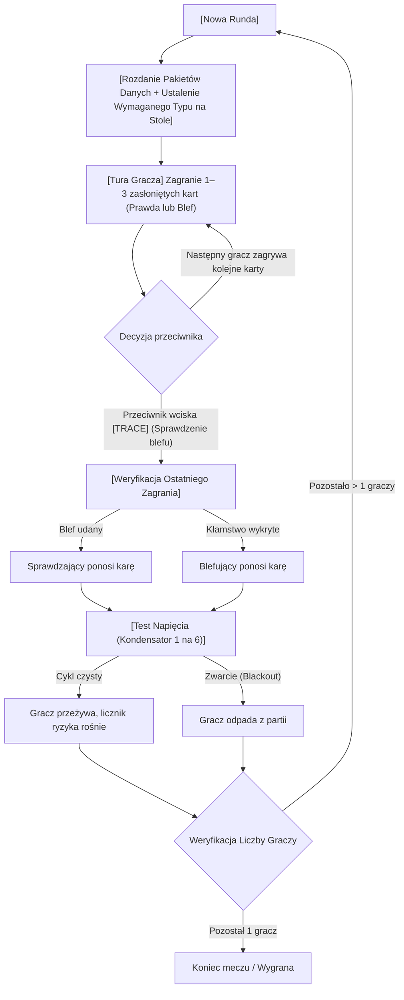

# Dokument Wizji Produktowej i Biznesowej (Game Pitch & Business Plan)

**Nazwa robocza:** Project: Overclock (alternatywnie: *Dead Circuit*)  
**Platforma:** Web (Desktop / Mobile browsers)  
**Model dystrybucji:** Free-to-Play z mikropłatnościami kosmetycznymi i pokojami prywatnymi  

---

## 1. Executive Summary & Wartość Rynkowa

**Project: Overclock** to przeglądarkowa, turowa gra blefu dla 2–4 graczy, łącząca tradycyjne zasady Oszusta (*Liar's Dice/Cards*) z rosnącym napięciem rosyjskiej ruletki w unikalnym klimacie lo-fi cyberpunk / retro-dystopii.

### Dlaczego rynek webowy?

- **Brak barier wejścia:** Zero pobierania gigabajtów danych ze Steama, instalacji launcherów czy konfiguracji sterowników — wystarczy przeglądarka.
- **Format wiralowy:** Model linku pokojowego (np. `game.io/room/XYZ`) idealnie sprawdza się na Discordzie, streamach (Twitch/Kick) oraz w szybkich sesjach ze znajomymi.
- **Luka rynkowa:** Sukcesy *Liar's Bar* i *Buckshot Roulette* wygenerowały ogromny popyt na gry oparte na blefie i egzekucji kary, ale na rynku brakuje lekkich, dopracowanych wizualnie odpowiedników dostępnych natychmiast z poziomu linku.

---

## 2. Tożsamość Marki i Bezpieczeństwo Prawne (Unikanie Plagiatu)

Mechanika tradycyjnego blefu karcianego leży w domenie publicznej. Aby całkowicie odciąć się od praw autorskich twórców *Liar's Bar*, projekt rezygnuje z motywów zwierzęcych gangsterów oraz klasycznej broni palnej:

| Element | Liar's Bar | Project: Overclock |
| :--- | :--- | :--- |
| **Świat gry** | Mroczny pub, antropomorficzne zwierzęta | Podziemny bunkier, serwerownia, terminale CRT i estetyka low-tech cyberpunk |
| **Mechanizm kary** | Klasyczny rewolwer / rosyjska ruletka | **Overvoltage Shunt** (losowe zwarcie neuro-kondensatora gracza) |
| **Karty** | Króle, Damy, Asy, Diabły | **Pakiety Danych** (Cipher-A, Cipher-B, Cipher-C), Glitch (Joker) |
| **Okrzyk sprawdzający** | „Liar!” | „Trace!” / „Glitch!” / „Breach!” |
| **Styl wizualny** | Realistyczne 3D (Unreal Engine) | Stylizowany komiks 2D z elementami 2.5D, dithering, scanlines i estetyka retro UI |

---

## 3. Pętla Rozgrywki (Core Loop)



```text
[Nowa Runda]
     │
     ▼
[Rozdanie Pakietów Danych + Ustalenie Wymaganego Typu na Stole]
     │
     ▼
[Tura Gracza] ──► Zagranie 1–3 zasłoniętych kart (Prawda lub Blef)
     │
     ├──► Następny gracz zagrywa kolejne karty do wspólnej puli
     │
     └──► Przeciwnik wciska [TRACE] (Sprawdzenie blefu)
               │
               ▼
     [Weryfikacja Ostatniego Zagrania]
          ├── Blef udany ──► Sprawdzający ponosi karę
          └── Kłamstwo wykryte ──► Blefujący ponosi karę
               │
               ▼
     [Test Napięcia (Kondensator 1 na 6)]
          ├── Cykl czysty ──► Gracz przeżywa, licznik ryzyka rośnie
          └── Zwarcie (Blackout) ──► Gracz odpada z partii
               │
               ▼
     [Weryfikacja Liczby Graczy] ──► Pozostał 1 gracz = Koniec meczu
```

> **Czas trwania meczu:** Średnio 5–8 minut, co napędza syndrom „jeszcze jednej partii”.

---

## 4. Model Biznesowy i Monetyzacja

Monetyzacja opiera się w całości na kosmetyce i wygodzie (*Quality of Life*). Brak jakichkolwiek elementów *Pay-to-Win*, by zachować pełną integralność rywalizacji.

### A. Przedmioty Kosmetyczne (Mikropłatności)
- **Customowe terminale i stół:** Wygląd obudowy monitora CRT, zielone/bursztynowe filtry kineskopowe, naklejki na terminal.
- **Efekty Zwarcia (Death Effects):** Różne animacje eliminacji (niebieskie wyładowanie łukowe, chmura dymu z procesora, stopiony interfejs).
- **Skórki kart (Data Sleeves):** Holograficzne rewersy, neony, zakłócenia wizualne glitch-art przy kładzeniu kart na stół.
- **Pakiety syntezatorów mowy:** Modyfikatory głosu lektora/komputera ogłaszającego tury i wyniki testów napięcia.

### B. Przepustka Pokoju / "Host Pass" (Opcjonalnie)
Dostęp do zaawansowanych parametrów pokoju prywatnego:
- Własny czas na turę (np. tryb blitz 5 sekund).
- Modyfikatory napięcia (np. start od szansy 2 na 6).
- Dedykowany tryb turniejowy z drabinką.
- Zapisywanie powtórek z meczu z opcją szybkiego eksportu wideo.

### C. Nienachalne Reklamy
- Banery wyłącznie na ekranie podsumowania meczu lub w poczekalni (lobby).
- Całkowity brak reklam w trakcie właściwej partii, aby nie wybijać graczy z napięcia.

---

## 5. Strategia Dystrybucji i Marketingu (Go-to-Market)

- **Format Streamer-Friendly:**
  - Tryb ukrywania kodu pokoju (ochrona przed wbijaniem losowych widzów na streamie).
  - Integracja z chatem platformy streamingowej (widzowie głosują, czy gracz blefuje).
- **Wirusowy potencjał krótkich form (TikTok / Shorts / Reels):**
  - Mechanizm losowego zwarcia i nagłej eliminacji generuje naturalne, emocjonalne reakcje graczy.
  - Przycisk po meczu umożliwiający szybkie pobranie klipu z eliminacji z nałożonym brandingiem gry.
- **Portale gier niezależnych:**
  - Publikacja na platformach webowych (itch.io, CrazyGames), co pozwala zebrać pierwszą bazę użytkowników organicznie bez budżetu reklamowego.

---

## 6. Kluczowe Wskaźniki Efektywności (KPI)

- **K-Factor (Współczynnik wiralowości):** Średnia liczba nowych graczy zaproszonych przez pojedynczy link do pokoju prywatnego (cel: > 1.3).
- **Retencja D1 / D7:** Procent powracających graczy (cel: D1 > 35%, D7 > 15%).
- **Czas spędzony w grze:** Średnio 20–30 minut na pojedynczą sesję (3–4 pełne mecze).
- **ARPPU:** Średni przychód z jednego płacącego użytkownika kupującego personalizacje stołu i terminala.

---

## 7. Architektura i Koszty Utrzymania

- **Lekki backend:** Cała gra opiera się na prostym przesyłaniu stanów (tekstowy format JSON przez WebSockets / SignalR); serwer nie wykonuje ciężkich kalkulacji fizycznych.
- **Minimalny koszt infrastruktury:** Podstawowy VPS za kilkadziesiąt złotych miesięcznie jest w stanie obsłużyć setki jednoczesnych pokoi.
- **Skalowalność:** Pokoje graczy są niezależne, co pozwala łatwo rozszerzać infrastrukturę o kolejne instancje w oparciu o Redis Backplane w przypadku gwałtownego napływu graczy.
