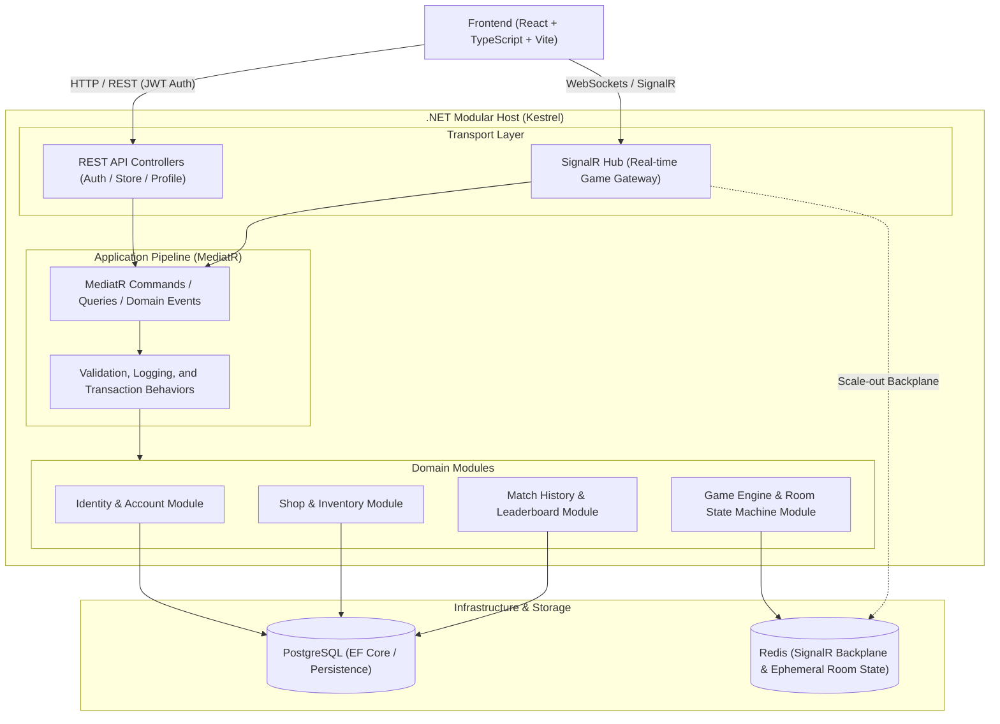

# 2. Core Technology Stack: .NET, React, MediatR, PostgreSQL, and Redis

Date: 2026-10-15

## Status

Accepted

## Context and Problem Statement

**Project: Overclock** (*Dead Circuit*) is a turn-based multiplayer web bluffing game for 2–4 players with real-time room mechanics, low latency, and meta-game features (user authentication, cosmetic inventory, match history, leaderboard).

An initial proposal evaluated a polyglot microservice architecture:
- Frontend: Angular
- Auth & Business Backend: .NET (C#)
- Real-time Game Engine: Go (WebSockets, Goroutines)
- Inter-service Communication: gRPC and RabbitMQ

While a polyglot distributed system looks impressive conceptually, for a 2–4 player turn-based web game driven by an independent/small engineering team, it introduces heavy cognitive overload:
1. Double backend stack maintenance (.NET + Go).
2. Protocol buffers and gRPC stub generation.
3. Message broker operational overhead (RabbitMQ/Kafka).
4. Complex local development and multi-container debugging.
5. Delayed Time-to-Market (TTM), risking project abandonment before a playable build is delivered.

We need a unified, performant, and developer-friendly technology stack that balances high-performance real-time gameplay with business capabilities (authentication, persistence, transactions).

## Decision Drivers

* **Time-to-Market (TTM):** Rapid iteration from prototype to a public, playable web link.
* **Operational Simplicity:** Single backend service deployable as a single Docker container on a low-cost VPS.
* **Low Latency & High Concurrency:** Capable of handling thousands of concurrent WebSocket connections and room state machines.
* **Rich Client-Side Experience:** Fast UI rendering, shader/scanline retro styling, seamless audio integration, and fluid card animations.
* **Code Reusability & Strong Typing:** Shared domain contracts and type safety across commands, queries, and events.

## Considered Options

1. **Option 1 (Polyglot Microservices):** Go (Game Engine / WebSockets) + .NET (Auth/Shop REST API) + gRPC + RabbitMQ + Angular.
2. **Option 2 (Modular Monolith):** .NET (ASP.NET Core, SignalR, MediatR) + React (TypeScript, Vite, Zustand) + PostgreSQL + Redis.
3. **Option 3 (Full-stack TypeScript):** Node.js / NestJS (Socket.io) + React + PostgreSQL + Redis.

## Decision Outcome

Chosen Option: **Option 2: .NET (Modular Monolith) + React + MediatR + PostgreSQL + Redis**.

### Architecture Overview

The system is structured as a **Modular Monolith** in .NET, strictly decoupled into domain modules:

### Key Components

1. **Backend Runtime — .NET 9 (C#):**
   - High-throughput web server (Kestrel) ranked among the top web frameworks in TechEmpower benchmarks.
   - Built-in asynchronous primitives (`Task`, `ValueTask`, `System.Threading.Channels`) provide goroutine-like concurrency and lightweight actor/in-memory queue patterns.
   - Single Dockerfile, unified dependency injection, and centralized logging/observability.

2. **Application Orchestration — MediatR (CQRS):**
   - Decouples API endpoints / SignalR Hub handlers from business logic using Command/Query Segregation (CQRS).
   - In-process domain events (e.g., `MatchFinishedNotification`) allow the `GameModule` to notify `StatsModule` and `EconomyModule` without tight coupling or external message brokers.
   - Pipeline behaviors encapsulate cross-cutting concerns (validation, metrics, exception handling).

3. **Real-time Gateway — ASP.NET Core SignalR:**
   - Manages WebSocket lifecycle, auto-reconnection, fallback transports, and client grouping per room ID (`game.io/room/XYZ`).
   - Binary Protobuf or compact JSON serialization over WebSockets.

4. **Persistence & Ephemeral State — PostgreSQL + Redis:**
   - **PostgreSQL:** ACID-compliant relational storage for user credentials, profiles, inventory/skins, match logs, and leaderboard rankings. Managed via Entity Framework Core.
   - **Redis:**
     - Acts as the SignalR Backplane for seamless horizontal scaling across multiple container instances.
     - Caches active room metadata, temporary session tokens, and connection-to-room mappings.
     - Provides distributed locks (`Redlock`) to eliminate race conditions during room join/leave events.

5. **Frontend — React + TypeScript (Vite):**
   - **State Management:** **Zustand** for lightweight, predictable room and turn state synchronization.
   - **Styling & Retro Aesthetics:** Tailwind CSS with custom CRT scanline, chromatic aberration, and dithering CSS shaders.
   - **Animation & Audio:** **Framer Motion** for card flip/deal animations and **Howler.js** for zero-latency 8-bit / dark-synth sound effects.

## Pros and Cons of the Selected Stack

### Positive Consequences
- **Single Language & Ecosystem on Backend:** C# across all domain modules, data access, and real-time handlers eliminates multi-language context switching.
- **Fast Development Velocity:** No gRPC boilerplate, no external message broker infrastructure (RabbitMQ/Kafka) needed during local development.
- **Zero Performance Compromise:** ASP.NET Core Kestrel + SignalR handles tens of thousands of concurrent WebSocket connections on minimal server resources (1 vCPU, 1–2 GB RAM).
- **Scalability Path:** Because domain boundaries are decoupled via MediatR and state scale-out is handled by Redis, any module (e.g., the Game Engine) can be extracted into an independent microservice later if traffic dictates.

### Negative Consequences / Trade-offs
- **In-process Memory Footprint:** While .NET has optimized GC and low memory overhead, it requires slightly more base memory than compiled Go (~60–100 MB baseline vs ~15–30 MB for Go).
- **Discipline Required for Modular Boundaries:** In a monolith, developers must enforce boundary rules (e.g., not directly querying another module's DbContext) through architectural tests (such as NetArchTest).
