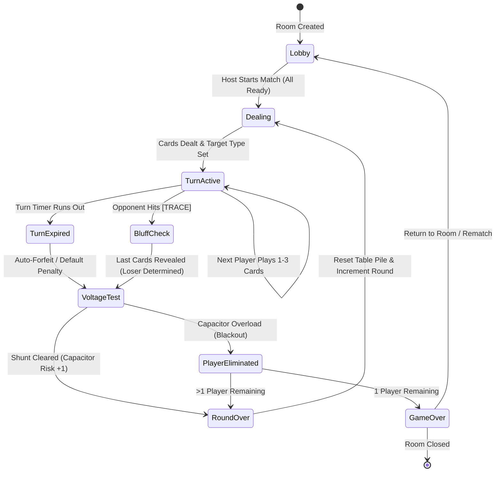

# 3. Real-Time Game Loop: SignalR, In-Memory State Machine, and Redis Backplane

Date: 2026-10-15

## Status

Accepted

## Context and Problem Statement

**Project: Overclock** (*Dead Circuit*) requires high responsiveness and strict synchronization for turn-based bluff mechanics:
- 2–4 players per room taking turns within strict time limits (e.g., 15-second turns, optional 5-second blitz).
- Hidden state: Each player holds encrypted/masked cards in hand (only visible to themselves), while the central table stack and card count are public.
- The bluff check (*Trace!*) and the voltage penalty (*Overvoltage Shunt* 1-in-6 capacitor test) must be calculated authoritatively on the server to prevent client tampering.
- Players may experience transient network drops or page reloads; they must be able to reconnect seamlessly without breaking the ongoing match.

We must define the real-time engine design, state machine architecture, concurrency control, and reconnection strategy.

## Decision Drivers

* **Authoritative Server:** The client must never calculate card legitimacy or capacitor shock results.
* **Concurrency & Race Condition Prevention:** Prevent simultaneous moves or actions submitted after timer expiration.
* **Low Latency & Immediate Feedback:** Sub-50ms round-trip delivery of play actions and state broadcasts.
* **Resilient Disconnections:** Allow players up to 30 seconds to reconnect before forfeiting.

## Decision Outcome

We adopt an **In-Memory Authoritative State Machine** per game room, coordinated via **ASP.NET Core SignalR**, using **Channels** for event sequencing and **Redis** for distributed state snapshots and horizontal scaling.

### State Machine Lifecycle

### Technical Design Specifications

1. **Authoritative Room Manager:**
   - Active rooms reside in-memory inside the `GameEngine` module, indexed by a unique alphanumeric room code (`RoomId`, e.g., `CYBER-7X9`).
   - Each room encapsulates a pure C# state machine. State transitions are strictly validated (e.g., rejecting an action if `CurrentPlayerId != callingPlayerId`).

2. **Concurrency Control via Single-Writer Loop:**
   - To avoid lock contention and threading race conditions, each room executes actions sequentially using a `System.Threading.Channels.Channel<GameAction>`.
   - Incoming SignalR invocations write actions to the channel, and a single-consumer background loop processes moves in deterministic order.

3. **Timer Management:**
   - Room timers use non-blocking `PeriodicTimer` or `CancellationTokenSource` linked to the turn duration.
   - If the player does not execute a valid move before expiration, the loop automatically transitions the state to penalty resolution.

4. **Information Masking (Anti-Cheat):**
   - The server transmits tailored state projections to each player:
     - Player receives their own cards in plaintext.
     - Opponents' hands are represented only by card count (`hand_count: 4`).
     - Played cards in the center pile remain masked (`pile_count: 7`) until a `Trace` command triggers the reveal.

5. **Disconnection and Reconnection Protocol:**
   - When a client disconnects, their seat enters a `Disconnected (Grace Period: 30s)` state.
   - The player's browser holds a secure session token in `sessionStorage`. Upon reconnecting to the SignalR Hub, the client calls `Reconnect(roomId, sessionToken)`.
   - The server validates the token, maps the new SignalR `ConnectionId` to the existing player seat, and sends a full `GameStateSnapshot` so the UI renders instantly.
   - If the grace period expires, the player is declared disconnected and their character suffers an overload blackout.

6. **Post-Match Domain Event:**
   - When a match reaches `GameOver`, the room state machine emits an in-memory MediatR notification: `MatchFinishedEvent(RoomId, WinnerId, Losers, Duration, TotalRounds)`.
   - The `StatsModule` and `EconomyModule` subscribe to this notification to update PostgreSQL records asynchronously, without blocking the room loop.

7. **Redis Scale-Out:**
   - For multi-instance deployment, Redis Pub/Sub acts as the SignalR backplane to route messages across instances.
   - Room metadata (Player IDs, Room Status, Host ID) is registered in Redis for global lookup.

## Pros and Cons

### Positive Consequences
- **Cheat-Proof:** Clients are purely reactive rendering engines; all rules and random rolls happen on the server.
- **Deterministic & Thread-Safe:** Channel-based sequencing eliminates multi-threaded race conditions.
- **Fast Execution:** In-memory state execution provides microsecond processing times with zero database queries during the active turn loop.

### Negative Consequences / Trade-offs
- If the server instance crashes mid-game, in-progress matches stored solely in memory would terminate unless periodic state snapshots are flushed to Redis. For quick 5-minute casual games, this trade-off is acceptable in exchange for maximum throughput.
