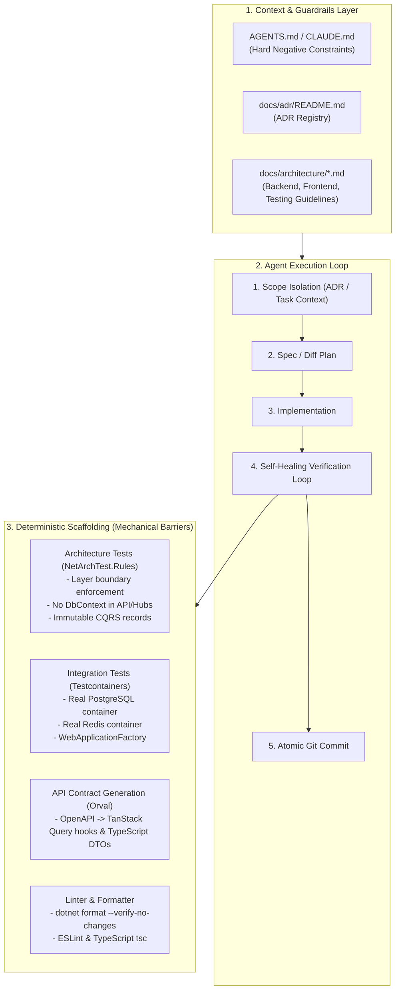

# 5. AI Architecture Harness and Deterministic Guardrails

Date: 2026-10-16

## Status

Accepted

## Context and Problem Statement

When using autonomous and semi-autonomous AI coding assistants (Claude Code, Cursor, Aider, GitHub Copilot Workspace, Antigravity) across multi-step feature implementations, projects commonly suffer from **architectural drift** and **context hallucination**:
1. AI agents often bypass architectural layers (e.g., injecting `DbContext` directly into presentation controllers or SignalR Hubs, or executing raw queries instead of dispatching through CQRS handlers).
2. Domain exceptions (`throw new Exception(...)`) get introduced instead of structured functional error handling (`Result<T>`), causing unhandled 500 crashes and broken real-time socket connections.
3. Database and caching interactions rely on fragile mocks (`Mock<IRepository>`) that pass unit tests but fail under live PostgreSQL or Redis concurrency semantics.
4. Frontend code duplicates backend C# DTO contracts manually in TypeScript, causing contract synchronization bugs between REST endpoints/SignalR events and React components.
5. Large prompts with monolithic instructions are ignored by models over long trajectories.

We need a deterministic, three-part architectural harness that establishes mechanical guardrails, structured context discovery, and a repeatable execution loop.

## Decision Drivers

* **Zero Architectural Drift:** Architecture constraints must be mechanically enforced by the compiler, linters, and unit/architecture test runners.
* **Bounded Context Loading:** AI agents must read lightweight root instructions (`AGENTS.md`) and lazily load detailed guidelines on-demand.
* **Real Verification (No Fake Mocks):** Integration tests must execute against real database engines and cache instances via containers.
* **Single Source of Truth:** API contracts must flow automatically from backend OpenAPI metadata to frontend TypeScript clients and hooks.
* **Deterministic Self-Healing Loop:** Agents must be equipped with verifiable CLI commands to validate changes prior to completing tasks.

## Considered Options

1. **Option 1: Monolithic System Prompt / Mega-Rules File:** Storing all architectural instructions, rules, and examples in a single huge `.cursorrules` or system prompt.
   - *Drawback:* Consumes excessive context tokens, triggers prompt degradation, and models still ignore markdown instructions during complex refactors.
2. **Option 2: Pure CI Enforcement (Post-Merge):** Relying solely on GitHub Actions pipelines to fail PRs.
   - *Drawback:* High feedback loop latency; agents working locally do not get immediate deterministic feedback while editing.
3. **Option 3: Three-Tier Harness (Context Guardrails + Deterministic Scaffolding + Execution Loop):**
   - **Tier 1 (Context & Guardrails):** ADR-first workflow, concise root rules (`AGENTS.md` / `CLAUDE.md`), and modular documentation in `docs/architecture/`.
   - **Tier 2 (Deterministic Scaffolding):** `NetArchTest` architectural unit tests, `Testcontainers` for integration testing, and OpenAPI + Orval for type-safe frontend codegen.
   - **Tier 3 (Execution Loop):** Standard 4-step workflow (Scope isolation, Spec plan, Self-healing run, Atomic commit).

## Decision Outcome

Chosen Option: **Option 3: Three-Tier Harness (Context Guardrails + Deterministic Scaffolding + Execution Loop)**.

### Architecture Overview



### Key Components

1. **Context & Guardrail Rules (`AGENTS.md` / `CLAUDE.md`):**
   - Enforces an **ADR-first** policy: Agents must verify `docs/adr/README.md` before implementing architectural changes.
   - Enforces strict **Negative Constraints**:
     - *.NET:* No raw SQL in controllers/Hubs; no business logic outside CQRS handlers and domain entities; zero `IQueryable` leakage; zero `throw new Exception` for domain errors (use `Result<T>`).
     - *PostgreSQL & EF Core:* Migrations only via `dotnet ef migrations add`; mandatory `.AsNoTracking()` on reads; transactions bounded by unit of work.
     - *Redis:* Mandatory TTL on all keys; keyspace standard `overclock:{module}:{entity}:{id}`; graceful cache-miss handling.
     - *React:* No direct `fetch`/`axios` in components; no hand-written REST DTO interfaces (generate via Orval); mandatory Zod validation for runtime SignalR events (ADR 0004).

2. **Mechanical Scaffolding:**
   - **`tests/Architecture.Tests`:** Powered by `NetArchTest.Rules`. Any attempt by an AI agent to inject `DbContext` into controllers/Hubs or create cross-module dependency leaks immediately fails the build.
   - **`tests/Integration.Tests`:** Powered by `Testcontainers.PostgreSql` and `Testcontainers.Redis`. Real database migrations run during test initialization; fake mocks are strictly prohibited for persistence.
   - **Contract Pipeline:** ASP.NET Core emits OpenAPI schemas; Orval generates frontend client SDKs (`npm run codegen:api`).

3. **Self-Healing Verification Loop (`scripts/verify.sh`):**
   - Agents must run and pass all checks before declaring task completion:
     ```bash
     ./scripts/verify.sh
     ```
   - If tests fail, the agent enters a self-healing loop: inspecting errors, fixing code, and re-running until exit code 0 is achieved.

### Enforcement

| Point | Mechanism |
|---|---|
| While the agent edits | PreToolUse hook (`scripts/guard-protected-paths.sh`): denies edits to generated code and migrations; forces human approval for harness files and accepted ADRs. |
| When the agent tries to finish | Stop hook (`scripts/agent-stop-gate.sh`): blocks completion while the tree is dirty and `verify.sh --fast` fails (max 3 forced retries). |
| On commit | `.githooks/pre-commit` (`verify.sh --fast`) and `.githooks/commit-msg` (Conventional Commits). |
| On push / PR | GitHub Actions runs full `verify.sh`; CODEOWNERS requires maintainer review for harness and ADR paths. |
| Context layer | `scripts/check-docs.sh` lints ADR numbering, status, index sync, and markdown links. |

`verify.sh` never reports success when gates were skipped, and treats a missing guardrail for an existing layer (e.g. backend code without `Architecture.Tests`) as a failure.

## Consequences

### Positive
* Prevents architectural drift across long chat sessions and multi-turn AI interactions.
* Replaces subjective instruction compliance with objective binary test outcomes.
* Eliminates out-of-sync frontend TypeScript DTOs through automated OpenAPI codegen.
* Guarantees realistic persistence and caching verification via real containers.

### Negative
* Requires Docker to be available for integration test execution (`Testcontainers`).
* Requires initial setup overhead of `NetArchTest` and Orval codegen tooling.
