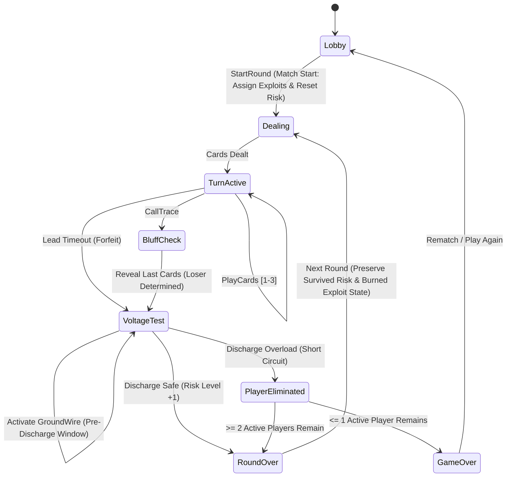

# 9. Voltage Test, Hardware Exploits and Timing Windows

Date: 2026-11-11

## Status

Proposed

## Context and Problem Statement

Phase 2 of **Project: Overclock** (*Dead Circuit*) implements elimination mechanics and tactical hardware modules:
- The bluff resolution penalty requires an escalating capacitor test (initial risk 1/6, incrementing by +1 upon survival, up to 6/6), calculated strictly on the server using cryptographically secure pseudorandom numbers (CSPRNG).
- Players hold single-use hardware exploits (`PacketSniffer`, `GroundWire`, `OverclockInjector`, `EmpFlare`) active during distinct *Timing Windows*.
- The codebase contained several discrepancies between documentation and implementation that must be authoritatively resolved:
  1. **Turn Timer Duration:** Code defines `TurnTimerEngine.DefaultTurnDuration = 15s`, while initial rules notes mentioned 20s.
  2. **Timeout Consequence:** Code passed turns on expiration, while ADR 0003 specified auto-forfeit to `VoltageTest`.
  3. **Overlapping Event Contracts:** `VoltageOverloadedEvent` and `TurnStartedEvent.CurrentVoltage` existed as legacy placeholders alongside planned `CapacitorDischargedEvent` and `PlayerEliminatedEvent`.
  4. **EMP Flare Activation Payload:** Activating `EmpFlare` requires declaring the next round target protocol, which was missing from the generic exploit command payload.
  5. **Exploit Distribution Model:** Whether players draw from a non-repeating pool or receive independent uniform draws.

## Decision Drivers

* **Authoritative Server Security:** All random rolls, timing window validations, and bluff verifications occur strictly server-side.
* **Information Asymmetry (Anti-Cheat):** `PacketSniffer` reveals one card exclusively to the invoking player over a private unicast channel, never in public state snapshots.
* **State Machine Predictability:** Deterministic transitions through `RoomState.VoltageTest` with decision watchdog timers to prevent disconnected players from stalling matches.
* **Zero Architectural Drift:** Clean encapsulation in Domain aggregates without leaking infrastructure or transport constructs.

## Considered Options

1. **Option 1: Direct Handler Invocation with Loosely Typed DTOs:** Handlers compute rolls and directly mutate seats.
2. **Option 2: Aggregate-Orchestrated Domain Model with Closed Effect Hierarchy (Chosen):**
   - Pure domain service `CapacitorDischargeEngine` executed exclusively via `GameRoom.DischargeCapacitor`.
   - Immutable `ExploitModule` on `PlayerSeat`.
   - Explicit `RoomState.VoltageTest` sub-state in `GameRoom`.
   - `GameRoom.ActivateExploit` returns a strongly typed `Result<ExploitEffect>` mapped by Application handlers to public broadcasts and private unicasts.

## Decision Outcome

Chosen Option: **Option 2**, settling all specification conflicts as follows:

### 1. Settled Conflicts
1. **Turn Timer Duration:** Standardized to **15 seconds** (`TurnTimerEngine.DefaultTurnDuration`). `OverclockInjector` shortens active turn timer to **5 seconds**.
2. **Timeout Semantics:**
   - If cards were played this round (`LastPlay != null`): Timeout triggers an automatic **`CallTrace`**.
   - If lead player times out without playing: Timeout triggers an immediate **forfeit into `VoltageTest`** for that player.
3. **Consolidated Contracts:**
   - Deprecate and replace `VoltageOverloadedEvent` with `CapacitorDischargedEvent(Guid PlayerId, int Roll, int RiskLevel, bool Overloaded)`.
   - Add `PlayerEliminatedEvent(Guid PlayerId, int Placement)`.
   - Update `GameStateSnapshotDto` and `PlayerGameStateDto` with `CapacitorRisk` and `ExploitModule` per seat.
4. **EMP Flare Payload:** `ActivateExploitCommand` includes optional `CardProtocol? NewTargetProtocol`.
5. **Exploit Draw:** Independent uniform draw at match start from `[PacketSniffer, GroundWire, OverclockInjector, EmpFlare]`. Modules are displayed face-up on the board and burned permanently (`IsBurned = true`) upon use.

### 2. State Machine Transitions

### 3. Timing Windows & Exploit Mechanics

| Exploit | Timing Window | Condition | Effect |
| :--- | :--- | :--- | :--- |
| **`PacketSniffer`** | **PreAction** | `State == TurnActive`, active turn player, `LastPlay != null` | Returns 1 random card from `LastPlay.Cards` via private SignalR unicast. |
| **`EmpFlare`** | **PreAction** | `State == TurnActive`, active turn player, valid `NewTargetProtocol` | Clears `_tablePile`, sets `LastPlay = null`, sets new target protocol, restarts turn timer. |
| **`GroundWire`** | **PreDischarge** | `State == VoltageTest`, pending discharge player | Reduces current risk by 50% (`Math.Max(1, Level / 2)`), burned immediately. |
| **`OverclockInjector`** | **Interrupt** | `State == TurnActive`, non-active player, immediately following opponent play | Reschedules turn timer deadline to `min(remaining, 5s)`. |

### 4. Domain Service & Aggregates

- **`CapacitorRisk`**: `readonly record struct` in `Domain.Voltage` with `Level` (1..6).
  - `Increment()`: increases level up to 6.
  - `Halve()`: returns `Math.Max(1, Level / 2)` (floor rounding: 2→1, 3→1, 4→2, 5→2, 6→3).
  - `IsOverload(int roll)`: `roll <= Level`.
- **`CapacitorDischargeEngine`**: Stateless domain service in `Domain.Services`. Signature: `DischargeOutcome Discharge(CapacitorRisk risk, IRandomSource rng)` with `roll = rng.Next(1, 7)`.
- **`ExploitModule`**: Immutable sealed record `(ExploitType Type, bool IsBurned)`.
- **Watchdog Timer in `VoltageTest`**: If the pending player holds an unburned `GroundWire`, a 5-second decision window is opened. If expired or player has no `GroundWire`, `DischargeCapacitor` executes immediately.

### Enforcement

1. **Deterministic Unit Tests:**
   - 10,000-iteration statistical test in `GameEngine.Domain.Tests` asserting uniform roll distribution (1–6) and overload rates matching `Level / 6.0` within ±1.5% margin.
   - Out-of-window exploit rejection tests in `GameEngine.Domain.Tests`.
2. **NetArchTest Rules:** Ensure `CapacitorDischargeEngine` remains in Domain, without dependency on Application or Host.
3. **Zod Runtime Validation:** Validate all new incoming SignalR payloads (`CapacitorDischargedEvent`, `PlayerEliminatedEvent`, `ExploitTriggeredEvent`) using Zod schemas matching JSON fixtures.
4. **Fast Verify Gate:** Maintained via `bash scripts/verify.sh --fast`.

## Consequences

### Positive

* Clear, unambiguous rules and timing windows eliminating edge-case races.
* Strict state machine integrity with automated watchdog timeouts prevents griefing.
* Information security maintained: opponent card previews remain completely masked from public transport.

### Negative

* Additional SignalR event types and hub methods increase contract surface.
* Watchdog timers require careful cancellation and sequence checks in the application layer.
