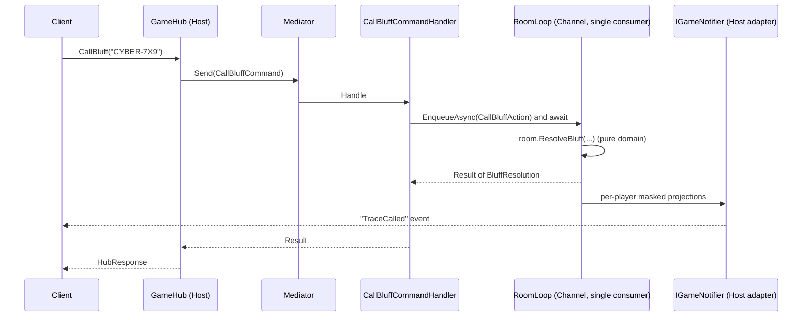

# Backend Architecture Guidelines (.NET 10)

This document establishes mandatory conventions for all backend code in **Project: Overclock**.
It refines — never overrides — the accepted ADRs ([0002](../adr/0002-technology-stack-and-modular-monolith.md), [0003](../adr/0003-realtime-engine-signalr-and-state-machine.md)).

---

## 1. Modular Monolith Layout

```
backend/
├── Overclock.slnx
├── src/
│   ├── Host/
│   │   └── Overclock.Host/             # ASP.NET Core: REST endpoints, SignalR hubs, DI composition root, OpenAPI
│   ├── SharedKernel/
│   │   └── Overclock.SharedKernel/     # Result type (ADR 0006), Entity/AggregateRoot base, IDomainEvent
│   └── Modules/
│       ├── GameEngine/
│       │   ├── Overclock.Modules.GameEngine.Domain/          # Room aggregate, state machine, cards, VoltageShunt (pure C#)
│       │   ├── Overclock.Modules.GameEngine.Application/     # Commands, Queries, Handlers, validators, ports (interfaces)
│       │   ├── Overclock.Modules.GameEngine.Infrastructure/  # Room registry + single-writer loop, Redis snapshots, adapters
│       │   └── Overclock.Modules.GameEngine.Contracts/       # Public records: integration events, SignalR event payloads
│       ├── Identity/   (same four projects)
│       ├── Economy/    (same four projects)
│       └── Stats/      (same four projects)
└── tests/
    ├── Architecture.Tests/
    └── Integration.Tests/
```

### Dependency rules (enforced by `backend/tests/Architecture.Tests`)

| Project | May reference |
|---|---|
| `*.Domain` | `SharedKernel` only |
| `*.Application` | own `Domain`, own `Contracts`, `SharedKernel`, **other modules' `Contracts`** |
| `*.Infrastructure` | own `Application` + `Domain`, `SharedKernel`, EF Core, StackExchange.Redis |
| `*.Contracts` | nothing but BCL (plain records) |
| `Overclock.Host` | every module's `Application`, `Infrastructure` (DI only), `Contracts` |

* A module **never** references another module's `Domain`, `Application`, or `Infrastructure`.
* Inter-module communication: `Contracts` records + in-process `Mediator` notifications (e.g. `MatchFinishedEvent`).

---

## 2. CQRS & Mediator Conventions (ADR 0008)

We use **`Mediator` (Source Generator)** by Martin Ullrich (MIT License) instead of `MediatR` ([ADR 0008](../adr/0008-replace-mediatr-with-compile-time-source-generated-mediator.md)).

* Commands and Queries are **immutable `sealed record` types** implementing `IRequest<Result<T>>` or `IRequest<Result>`.
* Naming:
  - Commands: `<Action><Entity>Command` (`PlayCardsCommand`, `CallBluffCommand`, `RegisterUserCommand`).
  - Queries: `Get<Entity>Query` / `List<Entities>Query` (`GetRoomStateQuery`).
  - Handlers: `<RequestName>Handler`, `internal sealed`, implementing `IRequestHandler<TRequest, Result<TResponse>>`.
* Every handler returns `ValueTask<Result>` or `ValueTask<Result<T>>` ([ADR 0006](../adr/0006-functional-error-handling-with-ardalis-result.md), [ADR 0008](../adr/0008-replace-mediatr-with-compile-time-source-generated-mediator.md)). No exceptions for domain/validation errors.
* Validation runs in a `ValidationBehavior<TRequest, TResponse>` (FluentValidation pipeline behavior) and returns `Result.Invalid(...)`.
* Error codes use `<Aggregate>.<Reason>` strings: `"Room.NotFound"`, `"Turn.NotYourTurn"`.

---

## 3. Real-Time Game Engine (ADR 0003)

Room state lives **in memory**, one authoritative `Room` aggregate per room code, mutated **only** by that room's single-writer loop (`Channel<GameAction>`). Handlers never load/save a room from a repository during play.



```csharp
// Application — command + handler (thin: routes the action into the room loop)
using Mediator;

public sealed record CallBluffCommand(string RoomCode, Guid AccuserPlayerId) : IRequest<Result<BluffResolutionDto>>;

internal sealed class CallBluffCommandHandler(IRoomRegistry rooms)
    : IRequestHandler<CallBluffCommand, Result<BluffResolutionDto>>
{
    public async ValueTask<Result<BluffResolutionDto>> Handle(CallBluffCommand request, CancellationToken ct)
    {
        if (!rooms.TryGet(request.RoomCode, out var room))
        {
            return Result.NotFound("Room.NotFound");
        }

        // The loop executes room.ResolveBluff(...) sequentially and completes the awaited Result.
        var outcome = await room.EnqueueAsync(new CallBluffAction(request.AccuserPlayerId), ct);
        return outcome.Map(resolution => resolution.ToDto());
    }
}
```

```csharp
// Domain — pure state transition, no I/O, no exceptions for rule violations
public Result<BluffResolution> ResolveBluff(Guid accuserId)
{
    if (State != RoomState.TurnActive)
    {
        return Result.Conflict("Turn.NotActive");
    }
    if (accuserId == LastPlay.PlayerId)
    {
        return Result.Invalid(new ValidationError("Bluff.SelfAccusation"));
    }
    // ... reveal last play, determine loser, transition to VoltageTest
}
```

* Randomness (shuffle, capacitor roll) comes from an injected `IRandomSource` so integration tests are deterministic.
* Projections sent to clients are masked per player (own hand in plaintext, others as counts).

---

## 4. Transport Layer (Host)

### REST endpoints
* Thin adapters: bind input → `sender.Send(...)` → `result.ToMinimalApiResult()`.
* Every endpoint declares OpenAPI metadata (`.WithName()`, `.Produces<T>()`, `.ProducesProblem()`) — the frontend client is generated from it ([ADR 0007](../adr/0007-api-contract-pipeline-orval-and-zod.md)).
* No `DbContext`, repositories, or business rules in endpoints.

### SignalR hubs
```csharp
[Authorize]
public sealed class GameHub(ISender sender) : Hub<IGameClient>
{
    public async Task<HubResponse> CallBluff(string roomCode)
    {
        var result = await sender.Send(new CallBluffCommand(roomCode, Context.User!.GetPlayerId()));
        return HubResponse.From(result);
    }
}
```
* Hub event payloads are records from a module's `Contracts` project (they are the SignalR contract mirrored by Zod on the client).

---

## 5. PostgreSQL & Entity Framework Core

* **One `DbContext` per module**, each with its own schema: `modelBuilder.HasDefaultSchema("identity")`. `GameEngine` has no `DbContext` during play.
* Migrations only via CLI, per module:
  ```bash
  dotnet ef migrations add <Name> \
    --project src/Modules/<Module>/Overclock.Modules.<Module>.Infrastructure \
    --startup-project src/Host/Overclock.Host \
    --context <Module>DbContext
  ```
* Never `EnsureCreated()`; migrations are applied at startup in development and by tests (`MigrateAsync`).
* Query handlers: `.AsNoTracking()` + projection with `.Select(...)` to DTOs.
* Repositories return materialized results (`List<T>`, `T?`), never `IQueryable<T>`.
* Cross-module writes use domain events + Outbox, not a shared transaction.

---

## 6. Redis

* Key namespace: `overclock:{module}:{entity}:{id}`
  - `overclock:game:room:CYBER-7X9` — room snapshot (crash recovery, ADR 0003 trade-off)
  - `overclock:game:lock:CYBER-7X9` — distributed lock for join/leave
  - `overclock:identity:session:{playerId}` — reconnect session
* Build keys only via a per-module `RedisKeys` static class — never string-concatenate keys inline.
* **Every write sets a TTL**: room snapshot 2 h, session 30 min, locks ≤ 5 s.
* A cache miss or Redis outage never yields a 500 from a read path: fall back to PostgreSQL or return `Result.NotFound`.
