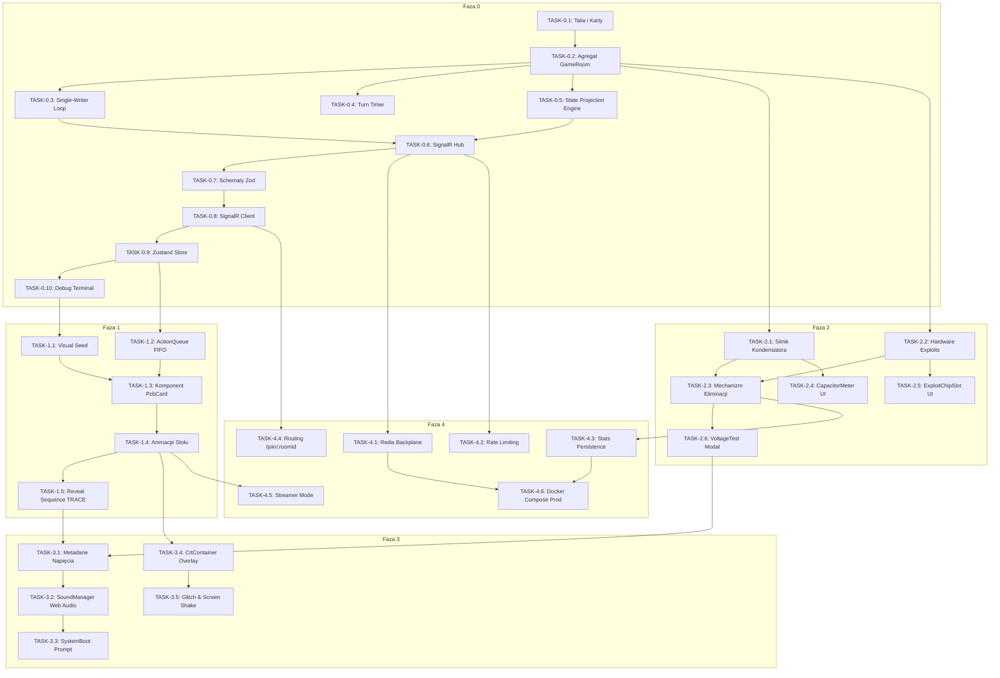

# Roadmapa Wdrożeniowa: Project Overclock (*Dead Circuit*)

Dokument definiuje operacyjny, chronologiczny plan implementacji gry webowej **Project: Overclock** (*Dead Circuit*).
Każde zadanie posiada zdefiniowaną ścieżkę w repozytorium, precyzyjny zakres techniczny oraz kryteria akceptacji.

---

## Spis Treści
1. [Standardy Wykonawcze i Przepływ Pracy](#standardy-wykonawcze-i-przepływ-pracy)
2. [Faza 0: Pętla Rdzenna w Minimalnym UI (Headless & Networking Core)](#faza-0-pętla-rdzenna-w-minimalnym-ui-headless--networking-core)
3. [Faza 1: Komponent Karty PCB i Stół Operacyjny (Visual Core & Action Queue)](#faza-1-komponent-karty-pcb-i-stół-operacyjny-visual-core--action-queue)
4. [Faza 2: Mechanika Napięcia i Egzekucji (Overvoltage Shunt & Hardware Exploits)](#faza-2-mechanika-napięcia-i-egzekucji-overvoltage-shunt--hardware-exploits)
5. [Faza 3: Audio, Efekty Diegetyczne i Polish (Atmosphere & Sensory Feedback)](#faza-3-audio-efekty-diegetyczne-i-polish-atmosphere--sensory-feedback)
6. [Faza 4: Skalowalność, Deployment i Go-To-Market (Production Release)](#faza-4-skalowalność-deployment-i-go-to-market-production-release)
7. [Matryca Zależności i Kolejność Wdrożeń](#matryca-zależności-i-kolejność-wdrożeń)

---

## Standardy Wykonawcze i Przepływ Pracy

Każde zadanie w roadmapie musi być realizowane zgodnie z regułami zawartymi w `AGENTS.md`:
1. **Brak logiki biznesowej poza domeną/CQRS:** Kontrolery API i Huby SignalR dispatchują żądania wyłącznie za pośrednictwem `ISender.Send`.
2. **Zero rzutowań typów na frontendzie:** Zdarzenia SignalR są walidowane w locie przez Zod (`safeParse`).
3. **Cenzura stanu (Anti-Cheat):** Serwer nigdy nie wysyła pełnego stanu ręki przeciwnika ani zakrytych kart na stole.
4. **Weryfikacja zmian:** Przed zatwierdzeniem etapu należy wykonać `bash scripts/verify.sh --fast`.

---

## Faza 0: Pętla Rdzenna w Minimalnym UI (Headless & Networking Core)

### Cel nadrzędny fazy (Definition of Done)
Działająca, autorytatywna pętla gry dla 2–4 graczy w surowym interfejsie testowym (Debug Terminal). Gracze tworzą pokój, synchronizują gotowość, otrzymują przydział kart (zgodnie z balansem talii), rozgrywają tury z 15-sekundowym limitem czasu i wywołują `TRACE`. Serwer rozstrzyga blef, zarządza stanem przez Channel Single-Writer oraz umożliwia reconnect w ciągu 30 sekund po zerwaniu socketu.

### Lista Zadań (Task Breakdown)

#### [Backend .NET]
- [ ] **`TASK-0.1` | Model Domeny Kart i Talii**
  - **Lokalizacja:** `backend/src/Modules/GameEngine/Overclock.Modules.GameEngine.Domain/`
  - **Zakres:**
    - Utworzenie enumów/rekordów `CardProtocol` (`Alpha`, `Beta`, `Gamma`, `Glitch`, `Corrupted`).
    - Implementacja encji `Card` z unikalnym `CardId` i właściwością `IsWildcard` / `IsForcedBluff`.
    - Implementacja agregatu `Deck` ze skalowaniem talii (2 graczy: 14 kart, 3 graczy: 18 kart, 4 graczy: 22 karty).
    - Algorytm tasowania Fishera-Yatesa oparty o `System.Security.Cryptography.RandomNumberGenerator`.
    - Wydzielenie losowej puli `BurnedPile` (niewidocznej dla graczy).
  - **Weryfikacja:** Testy jednostkowe sprawdzające proporcje typów kart dla 2, 3 i 4 graczy.

- [ ] **`TASK-0.2` | Agregat GameRoom i Maszyna Stanów**
  - **Lokalizacja:** `backend/src/Modules/GameEngine/Overclock.Modules.GameEngine.Domain/`
  - **Zakres:**
    - Encja `PlayerSeat`: `PlayerId`, `ConnectionId`, `SessionToken`, `List<Card> Hand`, `PlayerStatus` (`Active`, `Disconnected`, `Eliminated`).
    - Agregat `GameRoom`: stany `Lobby`, `Dealing`, `TurnActive`, `BluffCheck`, `RoundOver`, `GameOver`.
    - Metody domenowe: `AddPlayer`, `SetReady`, `StartRound`, `PlayCards`, `CallTrace`, `HandleDisconnect`, `HandleReconnect`.
    - Zabezpieczenie: walidacja czy zagrywający posiada deklarowane `CardId` w ręku.
  - **Weryfikacja:** Testy przejść maszyny stanów w `GameEngine.Domain.Tests`.

- [ ] **`TASK-0.3` | Single-Writer Channel Loop**
  - **Lokalizacja:** `backend/src/Modules/GameEngine/Overclock.Modules.GameEngine.Application/Rooms/`
  - **Zakres:**
    - Utworzenie menedżera pokoi `RoomManager` przechowującego aktywne instancje w pamięci RAM.
    - Implementacja kolejki `System.Threading.Channels.Channel<GameAction>` dla każdego aktywnego pokoju.
    - Pętla konsumenta wykonująca akcje sekwencyjnie w jednym wątku w tle, eliminując blokady `lock`.
  - **Weryfikacja:** Równoległe wysłanie 100 akcji do jednego pokoju; asercja braku race conditions i zachowania kolejności FIFO.

- [ ] **`TASK-0.4` | Czasomierz Tury (Turn Timer Engine)**
  - **Lokalizacja:** `backend/src/Modules/GameEngine/Overclock.Modules.GameEngine.Application/Services/`
  - **Zakres:**
    - Zarządzanie czasem tury za pomocą `CancellationTokenSource` i `TurnSequenceId`.
    - Odliczanie 15 sekund na ruch.
    - W przypadku timeoutu: automatyczne wygenerowanie akcji `TurnExpired` i przejście do procedury kary.
  - **Weryfikacja:** Test sprawdzający, czy brak akcji w oknie czasowym automatycznie przekazuje turę i nakłada karę.

- [ ] **`TASK-0.5` | Anti-Cheat State Projection Engine**
  - **Lokalizacja:** `backend/src/Modules/GameEngine/Overclock.Modules.GameEngine.Application/Projections/`
  - **Zakres:**
    - Transformacja stanu agregatu `GameRoom` do dedykowanego DTO per gracz (`PlayerGameStateDto`).
    - Odbiorca widzi swoje karty w postaci pełnych obiektów (`Id`, `Protocol`).
    - Karty rywali są cenzurowane – wysyłana jest wyłącznie liczba (`HandCount`).
    - Stos na stole podaje wyłącznie wielkość (`TablePileCount`), bez ujawniania zagranych typów.
  - **Weryfikacja:** Asercja w testach jednostkowych: DTO rywala nie zawiera identyfikatorów ani typów obcych kart.

- [ ] **`TASK-0.6` | SignalR Hub i Obsługa Reconnectu**
  - **Lokalizacja:** `backend/src/Host/Overclock.Host/Hubs/GameHub.cs`
  - **Zakres:**
    - Metody huba: `CreateRoom`, `JoinRoom`, `SetReady`, `PlayCards`, `CallTrace`, `Reconnect`.
    - Generowanie `SessionToken` (UUIDv4) zwracanego graczowi podczas dołączania.
    - `OnDisconnectedAsync`: oznaczenie gracza jako `Disconnected`, uruchomienie 30-sekundowego timera ochronnego.
    - `Reconnect`: weryfikacja `SessionToken`, przypisanie nowego `ConnectionId` i natychmiastowa wysyłka pełnego snapshotu.
  - **Weryfikacja:** Test integracyjny rozłączenia i ponownego podłączenia klienta z zachowaniem stanu gry.

#### [Frontend React]
- [ ] **`TASK-0.7` | Schematy Walidacji Zod dla SignalR**
  - **Lokalizacja:** `frontend/src/features/game/schemas/gameEvents.ts`
  - **Zakres:**
    - Schematy Zod: `RoomStateSnapshotSchema`, `CardsPlayedEventSchema`, `TraceCalledEventSchema`, `RoundStartedEventSchema`, `PlayerStatusChangedEventSchema`.
    - Eksport inferowanych typów TypeScript (`z.infer<typeof ...>`).
  - **Weryfikacja:** Testy Vitest parsujące wzorcowe fixture JSON z `tests/contracts/signalr/`.

- [ ] **`TASK-0.8` | SignalR Connection Manager**
  - **Lokalizacja:** `frontend/src/shared/realtime/gameConnection.ts`
  - **Zakres:**
    - Inicjalizacja `@microsoft/signalr` z `withAutomaticReconnect`.
    - Przechowywanie `SessionToken` i `RoomId` w `sessionStorage`.
    - Walidacja każdego przychodzącego payloadu przez `safeParse` – odrzucanie niezgodnych pakietów i logowanie błędów kontraktu.
  - **Weryfikacja:** Test jednostkowy: przekazanie zniekształconego JSON-a nie zawiesza klienta i jest odrzucane przez Zod.

- [ ] **`TASK-0.9` | Ephemeral Game Store (Zustand)**
  - **Lokalizacja:** `frontend/src/features/game/stores/useGameStore.ts`
  - **Zakres:**
    - Slices: `roomSlice` (status pokoju, gracze), `handSlice` (moje karty, selekcja), `turnSlice` (aktywny gracz, pozostały czas).
    - Akcje aktualizujące stan na podstawie sparsowanych zdarzeń SignalR.
  - **Weryfikacja:** Testy Vitest reduktorów Zustand sprawdzające poprawne przejścia stanu po zdarzeniach sieciowych.

- [ ] **`TASK-0.10` | Headless Debug Terminal UI**
  - **Lokalizacja:** `frontend/src/features/game/components/DebugTerminal.tsx`
  - **Zakres:**
    - Surowy interfejs w stylu retro-tekstowym do testów manualnych w wielu kartach przeglądarki.
    - Wyświetlanie JSON-a aktualnego stanu pokoju.
    - Przyciski akcji: `[Utwórz Pokój]`, `[Dołącz]`, `[Gotowy]`, `[Zagraj Karty]`, `[Sprawdź TRACE]`, `[Symuluj Rozłączenie]`.
  - **Weryfikacja:** Ręczne rozegranie pełnej partii na 3 kartach incognito w przeglądarce.

#### [Protokół / DTO]
- [ ] **`TASK-0.11` | Kontrakty C# i Fixture JSON**
  - **Lokalizacja:** `backend/src/Modules/GameEngine/Overclock.Modules.GameEngine.Contracts/` oraz `tests/contracts/signalr/`
  - **Zakres:**
    - Definicja rekordów C#: `PlayCardsCommand`, `CallTraceCommand`, `ReconnectCommand`, `GameStateSnapshotDto`.
    - Zapis wzorcowych plików JSON w `tests/contracts/signalr/` do testów kontraktowych.
  - **Weryfikacja:** Test weryfikujący zgodność serializacji C# z fixture JSON.

### Krytyczne pułapki inżynieryjne
- ❌ **Nie buduj stylizowanych komponentów:** Wszelkie animacje, grafiki i css-y na tym etapie odciągają uwagę od integralności maszyny stanów.
- ❌ **Nie wysyłaj kart rywali na klienta:** Klient nigdy nie powinien mieć w pamięci zakrytych kart na stole ani kart w rękach przeciwników.
- ❌ **Nie używaj `lock` w kodzie asynchronicznym C#:** Zawsze stosuj `System.Threading.Channels.Channel`.

### Mierzalny test akceptacyjny Fazy 0
```bash
# Uruchomienie testów architektury i integracji backendu
dotnet test backend/tests/Integration.Tests/ --filter "FullyQualifiedName~HeadlessGameLoopTests"
# Uruchomienie testów schematów kontraktowych frontendu
cd frontend && npm run test:contracts
```
- **Kryteria sukcesu:**
  1. Trzech wirtualnych graczy łączy się do pokoju, przechodzi fazę rozdania i rozgrywa 3 pełne tury.
  2. Gracz A symuluje utratę sieci (zamknięcie socketu), po czym łączy się w ciągu 15s z poprawnym tokenem sesji i odzyskuje stan ręki.
  3. Klient B weryfikuje devtools sieciowe – brak jakichkolwiek informacji o typach kart gracza A.

---

## Faza 1: Komponent Karty PCB i Stół Operacyjny (Visual Core & Action Queue)

### Cel nadrzędny fazy (Definition of Done)
W pełni responsywny stół operacyjny 2D/2.5D z diegetycznym wyglądem płytek drukowanych (PCB). Gracz może zaznaczać 1–3 karty, kłaść je na stół z animacją przelotu oraz obserwować sekwencję odkrywania kart (`TRACE`) z obrotem 3D. Wdrożona kolejka `ActionQueue` w Zustand gwarantuje, że szybkie zdarzenia sieciowe nie powodują przeskakiwania ani teleportacji animacji.

### Lista Zadań (Task Breakdown)

#### [Backend .NET]
- [ ] **`TASK-1.1` | Deterministyczny Seed Wizualny Karty**
  - **Lokalizacja:** `backend/src/Modules/GameEngine/Overclock.Modules.GameEngine.Application/`
  - **Zakres:**
    - Wyliczanie właściwości `VisualSeed` (int) dla każdej karty na podstawie skrótu `CardId`.
    - Przekazywanie `VisualSeed` w DTO karty, aby frontend generował identyczne warianty ścieżek PCB bez przesyłania tekstur.
  - **Weryfikacja:** Test jednostkowy: ten sam `CardId` zawsze generuje ten sam `VisualSeed`.

#### [Frontend React]
- [ ] **`TASK-1.2` | Menadżer Kolejki Akcji FIFO (ActionQueue)**
  - **Lokalizacja:** `frontend/src/features/game/stores/useActionQueue.ts`
  - **Zakres:**
    - Bufor FIFO przechowujący zdarzenia z SignalR: `{ id, type, payload, minDurationMs }`.
    - Blokowanie wykonywania kolejnej akcji do momentu wywołania zwrotnego `onAnimationComplete()` trwającej animacji.
    - Obsługa sytuacji awaryjnej (timeout 2000ms) wymuszającej przejście do kolejnego zdarzenia w razie zawieszenia animacji.
  - **Weryfikacja:** Test Vitest: napływ 3 zdarzeń w odstępie 10ms skutkuje sekwencyjnym wywołaniem z odstępem min. 300ms.

- [ ] **`TASK-1.3` | Wektorowy Komponent Karty PCB (`<PcbCard />`)**
  - **Lokalizacja:** `frontend/src/features/game/components/PcbCard.tsx`
  - **Zakres:**
    - Czysty SVG/Tailwind renderujący laminat PCB:
      - `Alpha`: zielona soldermaska, złocone ścieżki ENIG.
      - `Beta`: bursztynowa soldermaska, miedziane ścieżki.
      - `Gamma`: błękitna soldermaska, srebrne pady.
      - `Glitch`: purpura z artefaktami i napisem "OVERRIDE".
      - `Corrupted`: matowa czerń, przerwane ścieżki i spalone pady.
    - Rewers karty: diegetyczny schemat układu zasilania i mikrokontrolera.
    - Obsługa stanów: `selected`, `disabled`, `hovered`, `faceDown`.
  - **Weryfikacja:** Storybook / test komponentu renderującego warianty soldermaski i rewersu.

- [ ] **`TASK-1.4` | Animacje Stołu z Framer Motion**
  - **Lokalizacja:** `frontend/src/features/game/components/OperatingTable.tsx`
  - **Zakres:**
    - Płynny przelot kart z ręki gracza na blat stołu z dynamiczną rotacją (-5° do +5°) i cieniem rzucanym na laminat.
    - Reprezentacja stanowisk pozostałych graczy z zakrytymi miniaturami kart.
    - Komponent centralnego stosu kart na stole (`<TablePile />`).
  - **Weryfikacja:** Test w Playwright weryfikujący trajektorię ruchu kart na stole.

- [ ] **`TASK-1.5` | Kaskadowy Obrót Kart [TRACE] (3D Flip)**
  - **Lokalizacja:** `frontend/src/features/game/components/CardRevealSequence.tsx`
  - **Zakres:**
    - Wykorzystanie CSS 3D Transforms (`rotateY: 180deg`, `transform-style: preserve-3d`).
    - Kaskadowy obrót kart (stagger 150ms na każdą kartę z ostatniego zagrania).
    - Wizualne podświetlenie kłamstwa (czerwony puls) lub prawdy (zielony puls) po zakończeniu obrotu.
  - **Weryfikacja:** Asercja zakończenia animacji i wyemitowania sygnału do `ActionQueue`.

#### [Protokół / DTO]
- [ ] **`TASK-1.6` | Rozszerzenie Zdarzeń o Sygnaturę Sekwencji**
  - **Lokalizacja:** `backend/src/Modules/GameEngine/Overclock.Modules.GameEngine.Contracts/`
  - **Zakres:**
    - Dodanie pola `SequenceNumber` do wszystkich zdarzeń rozgrywki w celu weryfikacji ciągłości przez klienta.
    - Zaktualizowanie schematów Zod na frontendzie.
  - **Weryfikacja:** Test deserializacji zdarzeń z nowym polem.

### Krytyczne pułapki inżynieryjne
- ❌ **Nie wprowadzaj Three.js / Canvas 3D:** Standardowe CSS 3D transforms i wektory SVG są lżejsze, w pełni responsywne i nie powodują problemów na telefonach.
- ❌ **Nie modyfikuj stanu bez kolejki FIFO:** Bezpośrednie przypisanie zdarzenia `TraceCalled` do stanu zniszczy trwającą animację zagrania kart.

### Mierzalny test akceptacyjny Fazy 1
- **Scenariusz E2E (Playwright):**
  1. Gracz A zaznacza 2 karty w ręku i klika `[TRANSMIT]`.
  2. Karty wykonują animowany ruch na środek stołu w czasie 350ms.
  3. Gracz B natychmiast klika `[TRACE]`.
  4. W obu przeglądarkach karty na stole wykonują obrót 3D flip z kaskadą 150ms.
  5. Całość sekwencji wykonuje się w 60 FPS bez zacięć animacji i teleportacji elementów.

---

## Faza 2: Mechanika Napięcia i Egzekucji (Overvoltage Shunt & Hardware Exploits)

### Cel nadrzędny fazy (Definition of Done)
Pełna mechanika ryzyka i eliminacji. Przegrany blef uruchamia autorytatywny test kondensatora (1–6). Zwarcie eliminuje gracza z gry (*Blackout*), przenosząc go w tryb widza. Każdy gracz posiada 1 losowy moduł sprzętowy (*Packet Sniffer*, *Ground Wire*, *Overclock Injector*, *EMP Flare*), który może aktywować wyłącznie w dedykowanym oknie czasowym (*Timing Window*). Zużyty moduł ulega trwałemu przepaleniu.

### Lista Zadań (Task Breakdown)

#### [Backend .NET]
- [ ] **`TASK-2.1` | Silnik Rozładowania Kondensatora (CapacitorDischargeEngine)**
  - **Lokalizacja:** `backend/src/Modules/GameEngine/Overclock.Modules.GameEngine.Domain/Services/`
  - **Zakres:**
    - Śledzenie poziomu ryzyka na fotelu gracza (początkowo 1/6).
    - Zwiększanie poziomu o +1 po każdym przetrwanym teście (max 6/6).
    - Losowanie wyniku rzutu (1–6) za pomocą `RandomNumberGenerator.GetInt32(1, 7)`.
    - Jeśli `WylosowanaWartość <= PoziomRyzyka` -> zwarcie (`Overload = true`).
  - **Weryfikacja:** Test statystyczny 10 000 iteracji sprawdzający poprawność rozkładu prawdopodobieństwa.

- [ ] **`TASK-2.2` | Moduły Sprzętowe (Hardware Exploits)**
  - **Lokalizacja:** `backend/src/Modules/GameEngine/Overclock.Modules.GameEngine.Domain/Exploits/`
  - **Zakres:**
    - Przydział losowego modułu na start meczu: `PacketSniffer`, `GroundWire`, `OverclockInjector`, `EmpFlare`.
    - Weryfikator okien czasowych `TimingWindowValidator`:
      - `Pre-Action`: `PacketSniffer`, `EmpFlare`.
      - `Pre-Discharge`: `GroundWire` (obniżenie ryzyka o 50%).
      - `Interrupt`: `OverclockInjector` (skrócenie czasu tury rywala do 5s).
    - Trwałe zużycie modułu: ustawienie `IsBurned = true`.
    - Logika `PacketSniffer`: serwer wysyła podgląd 1 losowej karty z pakietu wyłącznie do gracza używającego modułu.
    - Logika `EmpFlare`: zniszczenie stosu stołu, zmiana protokołu wiodącego, przejście do nowej tury.
  - **Weryfikacja:** Testy domenowe aktywacji modułów i odrzucania prób użycia poza oknem czasowym.

- [ ] **`TASK-2.3` | Mechanizm Eliminacji i Koniec Meczu**
  - **Lokalizacja:** `backend/src/Modules/GameEngine/Overclock.Modules.GameEngine.Domain/`
  - **Zakres:**
    - Przełączenie gracza w stan `Eliminated` po zwarciu kondensatora.
    - Blokada przyjmowania jakichkolwiek komend od wyeliminowanego gracza.
    - Weryfikacja liczby aktywnych graczy: jeśli pozostał 1 gracz -> przejście do stanu `GameOver` i publikacja `MatchFinishedEvent`.
  - **Weryfikacja:** Test symulujący eliminację 3 z 4 graczy i zakończenie meczu.

#### [Frontend React]
- [ ] **`TASK-2.4` | Wskaźnik Kondensatora (`<CapacitorMeter />`)**
  - **Lokalizacja:** `frontend/src/features/game/components/CapacitorMeter.tsx`
  - **Zakres:**
    - Diegetyczny wskaźnik napięcia / linijka LED (1/6 do 6/6).
    - Drżenie igły/wskaźnika (mikro-jitter CSS) nasilające się wraz ze wzrostem ryzyka.
  - **Weryfikacja:** Test komponentu dla poziomów ryzyka od 1 do 6.

- [ ] **`TASK-2.5` | Pasek Modułów Sprzętowych (`<ExploitChipSlot />`)**
  - **Lokalizacja:** `frontend/src/features/game/components/ExploitChipSlot.tsx`
  - **Zakres:**
    - Komponent fizycznego układu scalonego DIP-8 z diodą stanu.
    - Podświetlenie i dostępność przycisku wyłącznie w dozwolonym oknie czasowym.
    - Efekt przepalenia: pęknięta tekstura, gasnąca dioda i dym po aktywacji.
  - **Weryfikacja:** Test interakcji: kliknięcie w oknie Pre-Action wysyła aktywację; kliknięcie po zużyciu jest zablokowane.

- [ ] **`TASK-2.6` | Sekwencja Testu Napięcia (`<VoltageTestSequence />`)**
  - **Lokalizacja:** `frontend/src/features/game/components/VoltageTestSequence.tsx`
  - **Zakres:**
    - Modal napięcia: animacja ładowania szyny prądowej.
    - Rozstrzygnięcie bezpieczne: zielony błysk, powrót wskaźnika do normy.
    - Zwarcie: uderzenie błękitnego łuku elektrycznego, zaciemnienie terminala i nałożenie nakładki widza (*SPECTATOR MODE*).
  - **Weryfikacja:** Test wizualny obu ścieżek rozstrzygnięcia wyładowania.

#### [Protokół / DTO]
- [ ] **`TASK-2.7` | DTO i Zdarzenia Modułów i Napięcia**
  - **Lokalizacja:** `backend/src/Modules/GameEngine/Overclock.Modules.GameEngine.Contracts/`
  - **Zakres:**
    - `ActivateExploitCommand(Guid RoomId, ExploitType Exploit)`.
    - `ExploitTriggeredEvent(Guid PlayerId, ExploitType Exploit)`.
    - `CapacitorDischargedEvent(Guid PlayerId, int Roll, int RiskLevel, bool Overloaded)`.
    - `PlayerEliminatedEvent(Guid PlayerId, int Placement)`.
  - **Weryfikacja:** Aktualizacja i walidacja schematów Zod.

### Krytyczne pułapki inżynieryjne
- ❌ **Nie losuj rzutu kością na frontendzie:** Całość obliczeń losowych musi pochodzić z serwerowego CSPRNG.
- ❌ **Nie rozsyłaj danych Packet Sniffer do wszystkich:** Informacja o podejrzanej karcie musi trafić wyłącznie do gracza używającego modułu.

### Mierzalny test akceptacyjny Fazy 2
- **Scenariusz Integracyjny:**
  1. Gracz A przegrywa blef przy poziomie ryzyka 2/6.
  2. Gracz A używa modułu `Ground Wire` w oknie Pre-Discharge -> serwer redukuje ryzyko do 1/6.
  3. Serwer wykonuje rzut. Wynik = 1.
  4. Serwer rozsyła `CapacitorDischargedEvent(Overloaded = true)`, a następnie `PlayerEliminatedEvent(Gracz A)`.
  5. Terminal Gracza A przełącza się w zablokowany tryb obserwatora; partia toczy się dalej między pozostałymi graczami.

---

## Faza 3: Audio, Efekty Diegetyczne i Polish (Atmosphere & Sensory Feedback)

### Cel nadrzędny fazy (Definition of Done)
Wdrożenie pełnej warstwy audiowizualnej lo-fi cyberpunk bez spadków wydajności (stabilne 60 FPS). Zintegrowany syntezator dźwięku Web Audio API odtwarza niskolatencyjne kliknięcia przekaźników, wyładowania łukowe i narastający pisk kondensatora. Interfejs zyskuje nakładkę kineskopu CRT (scanlines, winietowanie, poświata fosforowa, aberracja chromatyczna przy blefie).

### Lista Zadań (Task Breakdown)

#### [Backend .NET]
- [ ] **`TASK-3.1` | Metadane Napięcia i Sygnatury Dźwiękowe**
  - **Lokalizacja:** `backend/src/Modules/GameEngine/Overclock.Modules.GameEngine.Application/`
  - **Zakres:**
    - Dołączanie parametru `TensionLevel` (1–10) do snapshotu stanu, wyliczanego na podstawie liczby kart na stole i ryzyka kondensatorów.
    - Synchronizacja znacznika czasu `ServerTimeUtc` w celu wyrównania odtwarzania uderzeń dźwiękowych u wszystkich graczy.
  - **Weryfikacja:** Test jednostkowy wyliczenia `TensionLevel`.

#### [Frontend React]
- [ ] **`TASK-3.2` | Silnik Dźwiękowy Web Audio API**
  - **Lokalizacja:** `frontend/src/shared/lib/audio/SoundManager.ts`
  - **Zakres:**
    - Inicjalizacja `AudioContext` z buforowaniem próbek w pamięci (`AudioBuffer`).
    - Synteza proceduralna buczenia kondensatora za pomocą `OscillatorNode` (płynna modulacja częstotliwości 60 Hz -> 4 kHz).
    - Dźwięki: klik przekaźnika (`RELAY_CLICK`), przełącznik hebelkowy (`SWITCH_TOGGLE`), alarm weryfikacji (`TRACE_ALARM`), trzask wyładowania (`DISCHARGE_SNAP`).
  - **Weryfikacja:** Test jednostkowy odtwarzania próbek z mockowanym `AudioContext`.

- [ ] **`TASK-3.3` | Diegetyczny Ekran Wstępny (Audio Unlock Prompt)**
  - **Lokalizacja:** `frontend/src/features/game/components/SystemBootModal.tsx`
  - **Zakres:**
    - Ekran inicjalizacji terminala (`[INITIALIZE SYSTEM AUDIO]`) spełniający wymóg *User Gesture Policy* przeglądarek.
    - Przełączenie `AudioContext.state` ze `suspended` na `running` po kliknięciu użytkownika.
  - **Weryfikacja:** Weryfikacja w trybie incognito w Chrome/Firefox.

- [ ] **`TASK-3.4` | Nakładka Kineskopu CRT (`<CrtContainer />`)**
  - **Lokalizacja:** `frontend/src/shared/components/CrtContainer.tsx`
  - **Zakres:**
    - Warstwa scanlines w czystym CSS z subtelnym flickerem (akceleracja GPU przez `transform: translateZ(0)`).
    - Zaokrąglenie narożników i winietowanie monitora CRT.
    - Poświata fosforyzująca tekstu (`text-shadow: 0 0 8px rgba(34, 197, 94, 0.6)`).
  - **Weryfikacja:** Wizualna inspekcja i brak efektu mory na monitorach HiDPI.

- [ ] **`TASK-3.5` | Efekty Glitch i Chromatic Aberration**
  - **Lokalizacja:** `frontend/src/shared/components/GlitchOverlay.tsx`
  - **Zakres:**
    - Dynamiczne rozszczepienie kanałów RGB (chromatic aberration) w momencie ogłoszenia `TRACE`.
    - Fizyczny wstrząs ekranu (*Screen Shake*) przy uderzeniu wyładowania kondensatora.
  - **Weryfikacja:** Test wydajnościowy w Chrome DevTools.

- [ ] **`TASK-3.6` | Profilowanie i Optymalizacja 60 FPS**
  - **Lokalizacja:** `frontend/src/`
  - **Zakres:**
    - Usunięcie ciężkich filtrów `backdrop-filter: blur()`.
    - Wymuszenie `will-change: transform` na animowanych elementach PCB.
  - **Weryfikacja:** Raport Lighthouse Performance > 90 i stabilne 60 FPS podczas testu wyładowania.

### Krytyczne pułapki inżynieryjne
- ❌ **Nie odpalaj dźwięków przed interakcją użytkownika:** Naruszenie polityki Autoplay przeglądarki zawiesi silnik audio.
- ❌ **Nie używaj nieskompresowanych plików WAV:** Wszystkie próbki audio muszą być skompresowane (OGG/WebM, < 50 KB) lub syntezowane proceduralnie.

### Mierzalny test akceptacyjny Fazy 3
- **Test Płynności i Dźwięku:**
  1. Wejście na stronę w czystej sesji incognito -> kliknięcie `[INITIALIZE SYSTEM]` odblokowuje dźwięk bez ostrzeżeń w konsoli.
  2. Kliknięcie karty powoduje słyszalny klik przekaźnika w czasie < 15ms.
  3. Wywołanie zwarcia odpala jednocześnie: rozbłysk kineskopu, wstrząs ekranu i trzask wyładowania.
  4. Profiler klatek wykazuje minimum 58 FPS na urządzeniu ze zintegrowaną grafiką.

---

## Faza 4: Skalowalność, Deployment i Go-To-Market (Production Release)

### Cel nadrzędny fazy (Definition of Done)
Produkcyjny stos uruchamiany za pomocą `docker compose up -d`. SignalR jest wyskalowany za pomocą Redis Backplane z hierarchicznym nazewnictwem kluczy. Gracze dołączają przez bezpośrednie linki pokojowe (`/join/CYBER-7X9`). Wdrożony został tryb Streamer Mode (ochrona przed stream-snipingiem), asynchroniczny zapis statystyk meczowych do PostgreSQL oraz mechanizmy Rate Limitingu.

### Lista Zadań (Task Breakdown)

#### [Backend .NET]
- [ ] **`TASK-4.1` | Redis SignalR Backplane**
  - **Lokalizacja:** `backend/src/Host/Overclock.Host/Program.cs`
  - **Zakres:**
    - Konfiguracja `AddStackExchangeRedis` jako backplane dla SignalR.
    - Zastosowanie konwencji kluczy: `overclock:game:room:{id}` oraz `overclock:game:lock:{id}`.
    - Rejestracja metadanych pokoju w Redis z czasem wygaśnięcia TTL (2 godziny).
  - **Weryfikacja:** Test integracyjny z Testcontainers: 2 instancje backendu wymieniają zdarzenia graczy w jednym pokoju.

- [ ] **`TASK-4.2` | Rate Limiting i Ochrona Zasobów**
  - **Lokalizacja:** `backend/src/Host/Overclock.Host/Program.cs`
  - **Zakres:**
    - Konfiguracja `Microsoft.AspNetCore.RateLimiting`: limit tworzenia pokoi (max 5/min na IP) oraz akcji SignalR (max 10 akcji/sekundę).
    - Zabezpieczenie przed atakami typu Denial of Service.
  - **Weryfikacja:** Test automatyczny wysyłający serię 50 zapytań w 1 sekundę – weryfikacja odpowiedzi HTTP 429.

- [ ] **`TASK-4.3` | Asynchroniczny Zapis Wyników (StatsModule)**
  - **Lokalizacja:** `backend/src/Modules/Stats/Overclock.Modules.Stats.Application/`
  - **Zakres:**
    - Subskrypcja zdarzenia `MatchFinishedEvent`.
    - Asynchroniczny zapis statystyk meczu (czas trwania, liczba rund, wygrany, zużyte moduły) do bazy PostgreSQL.
    - Izolowany `StatsDbContext` ze schematem bazy `stats`.
  - **Weryfikacja:** Test integracyjny sprawdzający obecność rekordu w PostgreSQL po zakończeniu meczu.

- [ ] **`TASK-4.4` | Health Checks i Monitoring**
  - **Lokalizacja:** `backend/src/Host/Overclock.Host/Program.cs`
  - **Zakres:**
    - Endpointy `/healthz` (liveness) oraz `/readyz` (readiness sprawdzający połączenie z Redis i Postgres).
  - **Weryfikacja:** Zapytanie HTTP GET zwracające kod 200 OK w kontenerze.

#### [Frontend React]
- [ ] **`TASK-4.5` | Dynamiczny Routing Pokojów (`/join/:roomId`)**
  - **Lokalizacja:** `frontend/src/app/routes/JoinRoomRoute.tsx`
  - **Zakres:**
    - Obsługa bezpośredniego wejścia z linku: gracz podaje wyłącznie pseudonim i natychmiast trafia do lobby.
    - Generowanie przycisku "Kopiuj Link do Pokoju" w lobby.
  - **Weryfikacja:** Test E2E: otwarcie linku na drugim oknie przeglądarki bezpośrednio dołącza do pokoju.

- [ ] **`TASK-4.6` | Tryb Bezpieczny dla Streamerów (Streamer Mode)**
  - **Lokalizacja:** `frontend/src/features/game/components/StreamerSettings.tsx`
  - **Zakres:**
    - Opcja w menu: maskowanie kodu pokoju (`CYBER-***`).
    - Opcja "Hold to Reveal Cards": karty w ręku są zakryte domyślnie i odsłaniają się wyłącznie podczas trzymania klawisza (np. Spacji).
  - **Weryfikacja:** Test komponentu weryfikujący zakrycie kart w trybie streamera.

- [ ] **`TASK-4.7` | Produkcyjny Bundling i Nginx Proxy**
  - **Lokalizacja:** `frontend/nginx.conf` oraz `frontend/vite.config.ts`
  - **Zakres:**
    - Konfiguracja Nginx: serwowanie plików statycznych, proxy do API i SignalR z nagłówkami WebSocket `Upgrade`.
    - Kompresja Brotli/Gzip.
  - **Weryfikacja:** Weryfikacja nagłówków HTTP i poprawnego zestawiania połączenia WSS przez Nginx.

#### [Infrastruktura & DevOps]
- [ ] **`TASK-4.8` | Docker Compose Produkcyjny**
  - **Lokalizacja:** `docker-compose.prod.yml`
  - **Zakres:**
    - Kontenery: `backend` (.NET 10), `frontend` (Nginx), `redis` (Alpine), `postgres` (Alpine).
    - Konfiguracja wolumenów danych, limitów pamięci i automatycznego restartu (`restart: unless-stopped`).
  - **Weryfikacja:** Uruchomienie `docker compose -f docker-compose.prod.yml up -d` na czystym środowisku Linux.

### Krytyczne pułapki inżynieryjne
- ❌ **Nie zapisuj ruchów graczy do bazy danych PostgreSQL:** Całość aktywnego meczu żyje w RAM i Redis. Baza danych widzi wyłącznie końcowy raport meczu.
- ❌ **Nie przekazuj tokenów autoryzacyjnych w URL:** Link do pokoju zawiera wyłącznie publiczny kod pokoju (`CYBER-7X9`).

### Mierzalny test akceptacyjny Fazy 4
```bash
# Test obciążeniowy pętli pokoi
k6 run tests/load/game-loop-stress.js
```
- **Kryteria sukcesu:**
  1. 50 równoległych pokoi (200 wirtualnych graczy) rozgrywających mecze przez 5 minut.
  2. Wskaźnik p99 opóźnienia SignalR poniżej 80ms.
  3. Zużycie pamięci kontenera backendu poniżej 450 MB RAM, brak wycieków pamięci.
  4. Wykonanie `bash scripts/verify.sh` na środowisku CI kończy się kodem wyjścia 0.

---

## Matryca Zależności i Kolejność Wdrożeń


