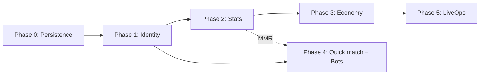

# Meta-Game Roadmap: Project Overclock (*Dead Circuit*)

> Status: **Draft** · Created: 2026-11-20 · Follows: [development-roadmap.md](development-roadmap.md)
>
> Business-analysis proposal for the next stage of the product, after the core loop.
> Architectural context: [ADR 0002](../adr/0002-technology-stack-and-modular-monolith.md),
> [ADR 0003](../adr/0003-realtime-engine-signalr-and-state-machine.md),
> [PCB Data Cards BDR](../business/adr_pcb_data_cards_business_design_decision.md),
> [game rules & balance](../business/game_rules_and_balance.md).
>
> This roadmap is **not** an accepted decision. Every phase that adds a dependency, changes a
> protocol, or shifts module boundaries needs its own **Proposed** ADR first (`scripts/new-adr.sh`).

---

## Current State (as of 2026-11-20)

| Area | State |
| :--- | :--- |
| `GameEngine` module | Complete: rooms, bluff/`TRACE`, voltage test, hardware exploits, characters, disconnect grace, host succession. |
| `Identity`, `Economy`, `Stats` modules | Empty shells (only `.csproj` files, no code). |
| Persistence | None. No `DbContext`, no Redis usage; rooms live in `InMemoryGameRoomRegistry`. |
| Player identity | A nickname plus a connection. Nothing survives closing the browser tab. |
| Monetisation design | Cosmetics pipeline already described in the PCB Data Cards BDR (substrates, trace metals, death FX). |

**Key finding:** the game works as a single match, but nothing brings a player back for the next one.
This roadmap closes that loop: *identity → progress → rewards → players to play with → fresh content*.

---

## Phase 0: Persistence Foundation (prerequisite for everything else)

**Goal:** a finished match leaves a trace.

- [ ] **`META-0.1` | First per-module `DbContext` and migrations**
  - One schema per module, migrations via `dotnet ef migrations add`, Testcontainers integration tests.
- [ ] **`META-0.2` | `MatchFinishedEvent` integration event**
  - Published from `GameEngine.Contracts`: participants, placements, `TRACE` count, discharges, exploits used, duration.
  - `Stats` and `Economy` consume it without knowing the engine's internals.
  - Overlaps with `TASK-4.3` in the development roadmap; this roadmap broadens its payload.
- [ ] **`META-0.3` | Outbox for match results**
  - A completed match must not be lost if the process crashes.

> ⚠️ **ADR required:** new cross-module communication channel (AGENTS.md §1).

---

## Phase 1: Identity — "who am I"

**Goal:** players keep an identity across sessions without a mandatory sign-up.

- [ ] **`META-1.1` | Guest-first accounts**
  - First visit silently creates a guest account with a token, preserving the *zero-install, instant access* pillar.
  - The guest can later be upgraded to a full account (email or OAuth: Discord, Google).
- [ ] **`META-1.2` | JWT in REST and SignalR**
  - `PlayerId` stops being tied to a connection; reconnecting works from another device.
- [ ] **`META-1.3` | Player profile**
  - Unique nickname, preferred character, avatar.
- [ ] **`META-1.4` | Moderation basics**
  - Nickname filter, player reporting.

> ⚠️ **ADR required:** auth library choice (ASP.NET Identity vs external provider) and hub contract
> change (`CreateRoomRequest` / `JoinRoomRequest` stop accepting a free-form nickname).

---

## Phase 2: Stats — "how am I doing"

**Goal:** progress for the player, data for the designer.

- [ ] **`META-2.1` | Match history**
  - List of past matches with a timeline (who called `TRACE` on whom, who bluffed).
- [ ] **`META-2.2` | Game-specific profile stats**
  - `TRACE` accuracy (how many calls caught a bluff).
  - Bluff success rate (how many lies went through).
  - Discharges survived and "highest risk survived".
  - Win rate per character and per exploit.
- [ ] **`META-2.3` | Ranking and MMR**
  - ELO or Glicko adapted to 2–4 player free-for-all, with seasons.
  - Leaderboard in Redis as a sorted set with a per-season TTL (Redis TTL rule).
- [ ] **`META-2.4` | Balance dashboard for designers**
  - In practice more valuable than the leaderboard. Answers questions such as: does `Ground Wire` win
    disproportionately often? Is the 14-card 2-player deck too predictable?
  - Validates [game_rules_and_balance.md](../business/game_rules_and_balance.md) against real data.

---

## Phase 3: Economy — "why keep playing"

**Goal:** a reward loop and monetisation **without pay-to-win**.

- [ ] **`META-3.1` | Soft currency (working name: *Scrap*)**
  - Earned per match, with bonuses for placement and spectacular plays.
- [ ] **`META-3.2` | Inventory and cosmetics shop** (per the PCB Data Cards BDR)
  - Card substrate (FR-4, Military Olive, Polar White, Acrylic).
  - Trace metals (ENIG, Bare Copper, RGB).
  - Death FX (blown capacitor, smoke, sparks).
  - 3D character skins (`ghost`, `volt`, `proxy`, `null`).
- [ ] **`META-3.3` | Loadout visible to opponents**
  - Cosmetics only matter if rivals see them → equipped items go into the room snapshot (SignalR contract change).
- [ ] **`META-3.4` | Daily and weekly contracts**
  - e.g. "Catch 3 bluffs", "Survive a discharge at 4/6 risk".
- [ ] **Hard rule:** hardware exploits stay random; nothing in the shop grants a gameplay advantage.
- [ ] **Later:** premium currency and payments, each behind its own ADR.

---

## Phase 4: Social & Matchmaking

**Goal:** solve the cold-start problem — the game needs 2–4 people at the same time.

- [ ] **`META-4.1` | Quick match**
  - Queue that matches players with similar MMR.
- [ ] **`META-4.2` | Bots that fill empty seats**
  - Likely the single most important retention feature at low player counts.
  - The domain already helps: every action is a command and `TurnExpired` exists.
- [ ] **`META-4.3` | Rematch, invite links, friends list**
- [ ] **`META-4.4` | Quick chat and emotes**
  - Canned lines and emotes; in a bluffing game, taunts are part of the gameplay.
- [ ] **`META-4.5` | Spectator mode**
  - Requires a separate state projection with no hands visible.

---

## Phase 5: LiveOps & New Content

- [ ] **`META-5.1` | New exploits and timing windows**
  - e.g. *Firewall* (blocks an opponent's exploit), *Signal Jammer*.
- [ ] **`META-5.2` | Game modes**
  - Ranked, Hardcore (one discharge and you are out), Speed (10 s per turn), tournaments.
- [ ] **`META-5.3` | Seasonal pass**
  - Ties Stats seasons to Economy rewards.

---

## Priorities & Dependencies

**Recommended MVP slice:** Phase 0 → guest accounts (`META-1.1`, `META-1.2`) → match history with basic
stats (`META-2.1`, `META-2.2`) → bots (`META-4.2`). Leaderboards and the shop come once there is someone to
reward — cosmetics without players and without identity deliver nothing.

## Success Metrics

- D1 and D7 retention.
- Matches per session.
- Time to first match.
- Room fill rate.
- Later: guest → full account conversion.
